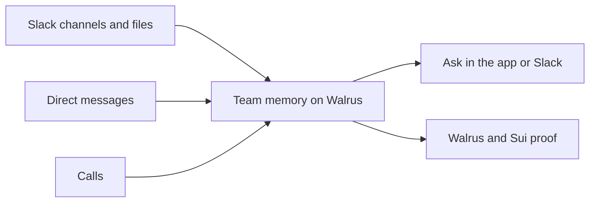

<p align="center">
  
</p>

<h1 align="center">Sederunt</h1>

<p align="center">
  The assistant that remembers what you agreed.
</p>

<p align="center">
  Decisions, announcements and files, kept on Walrus for the whole team.
</p>

<p align="center">
  <a href="https://sederunt.vercel.app"></a>
</p>

<p align="center">
  <a href="https://sederunt.vercel.app"><strong>Open Sederunt</strong></a>
  &nbsp;·&nbsp;
  <a href="docs/blog/total-recall.md">How it works</a>
  &nbsp;·&nbsp;
  <a href="docs/runbooks/new-user-live-demo.md">Demo runbook</a>
  &nbsp;·&nbsp;
  <a href="#run-locally">Run locally</a>
</p>

https://github.com/user-attachments/assets/63f84845-ff8a-435d-ae00-6054b085571f

Sederunt is the assistant that remembers what your team agreed. It keeps decisions, announcements, and files on Walrus Memory so the people who should see them can find them later in the app or ask from Slack. Slack channels, shared files, and calls all feed that same team memory — a meeting is one source, not the whole product.

**Live app:** [sederunt.vercel.app](https://sederunt.vercel.app)

Submitted to **Track 02: Smart Agents for Real Life** at the Tatum × Walrus Total Recall hackathon. It uses Walrus Memory to keep decisions and Tatum to read their Sui proofs. [Read the project write-up](docs/blog/total-recall.md).

## Team memory



1. **Keep what the team agreed.** Posts and files in a Slack channel are stored for that channel. An announcement can name a file, and the file stays in Walrus Console. A call is another source: connect a calendar or add the assistant with a meeting link, then address it to keep a decision or request a change.
2. **Ask later.** Open a room in the app to see its decisions, activity, and files, or ask in **Ask AI** or Slack. @mention the assistant in a channel to ask there. In a DM, you can ask about any channel you are a member of. Access to a decision follows its stored invitation.
3. **Follow through.** Connect tools such as Linear and Google Calendar. Explicit requests follow the tool's setting: **Run automatically** is on by default, and turning it off makes the request wait for approval. Suggested follow-ups require the requester's approval.
4. **Check the source.** Open a decision's proof to see the available Walrus and Sui details. Related files are kept through Walrus Console.

Each Slack team maps to one Sederunt space. Private notes stay on the personal account.

> **Project status:** Sederunt is a hackathon project. A full live Slack and call rehearsal is still needed to validate the end-to-end follow-up flow. A connected status or passing test suite alone does not prove that a record was kept or a ticket was filed. See the [demo runbook](docs/runbooks/new-user-live-demo.md) for the checks.

## What is connected

| Part | Role in Sederunt |
| --- | --- |
| **Walrus Memory and Walrus Console** | Store decision records and related files. |
| **Sui and Tatum** | Read the on-chain object and checkpoint used to verify a record. |
| **Slack** | Keep channel context and files, answer questions, and deliver eligible follow-ups. |
| **Google Meet and Recall.ai** | Bring the assistant into a call and receive meeting events. |
| **Linear and Google Calendar** | Carry out supported requests through connected tools. |
| **Supabase and Redis** | Support identity, workspace data, and durable application state. |

A decision is available only to an authorized reader. The assistant checks the room and requester before returning a record; a tool write passes through the common allow gate. Inferred proposals do not become authorized writes by themselves. See the [requirements](docs/requirements/sederunt.md) and [access design](docs/design/access.md) for the full rules.

## Run locally

**Prerequisites:** Node.js **24.15.0** (pinned in [`.nvmrc`](.nvmrc)), npm, and Git. The commands below use [`nvm`](https://github.com/nvm-sh/nvm) to select Node.

```sh
git clone https://github.com/ngna3007/sederunt.git
cd sederunt
nvm install
nvm use
npm ci
SEDERUNT_AUTH_FAKE=1 npm start
```

Open **[http://127.0.0.1:8787/console](http://127.0.0.1:8787/console)**. In the sign-in screen, click **Continue with Google** to use the local fake identity and follow the workspace setup. This is a development profile: it uses local identities and a fake calendar. It does not connect a real Slack workspace, meeting, Linear account, or Walrus storage. Without a configured company memory account, the console may say the account is not loaded.

To configure real integrations, copy [`.env.example`](.env.example) to `.env` and provide your own credentials, then start the server:

```sh
cp .env.example .env
# Configure the services you intend to use in .env.
node --env-file=.env src/server.js
```

Start with the [Google sign-in setup](docs/auth-setup.md), [connector guide](docs/connectors.md), and [Walrus Files design](docs/design/walrus-files.md). Never commit `.env`, tokens, private keys, or `.local/`. A production deployment also needs the required database migrations, durable stores, and recovery configuration described in the [release report](docs/reports/2026-11-09-product-reliability.md).

## Test

```sh
npm test                 # Node test suite
npm run check:syntax     # JavaScript syntax
npm run check:integration # disposable database and Redis checks; requires Docker
npm run check:audit      # npm dependency audit
npm run check:secrets    # Git-history scan; requires Docker and full history
```

The regular test suite can skip tests that require external services. The integration command creates and removes dedicated disposable services; see the [CI guide](.github/workflows/README.md) for the exact checks and remaining gaps.

## Explore the code

| Path | Start here for… |
| --- | --- |
| [`src/server.js`](src/server.js) | The Node server and HTTP routes |
| [`src/memory/`](src/memory/) and [`src/ask/`](src/ask/) | Decision storage, recovery, and questions |
| [`src/slack/`](src/slack/) and [`src/files/`](src/files/) | Slack interactions, file access, and background jobs |
| [`src/meeting/`](src/meeting/) | Meeting events |
| [`src/domain/`](src/domain/) | Invitation checks and the allow gate |
| [`src/tatum/`](src/tatum/) | Tatum gRPC reads and proof verification |
| [`docs/`](docs/README.md) | Requirements, design notes, and operations |

For a concrete on-chain example, inspect the [booth decision on Suiscan](https://suiscan.xyz/mainnet/object/0xf734ea6c946482d9bf28f6443ea6529099a67cc306717562361cd463438de944) and its [recorded mainnet proof](docs/hackathon/mainnet-seed-proof.json).
