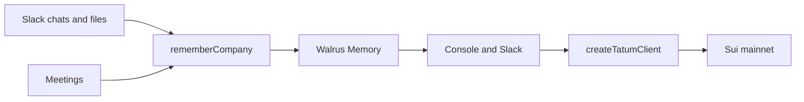

# Architecture

Sederunt is the assistant that remembers what you agreed. Team memory is stored on Walrus. A meeting is one source alongside Slack chats and files.

## Walrus + Tatum integration

Walrus Memory writes and reads go through [`src/memory/company.js`](../src/memory/company.js). The in-call path defers those writes in [`src/meeting/agent-http.js`](../src/meeting/agent-http.js). Idempotency keys are built in [`src/typed-path.js`](../src/typed-path.js). A Walrus 409 for an activity key that was already stored is success in [`src/memory/retry.js`](../src/memory/retry.js) (`isAlreadyStored`).

Every Sui read goes through [`src/tatum/client.js`](../src/tatum/client.js) and [`src/tatum/transport.js`](../src/tatum/transport.js): native gRPC to the Tatum Sui gateway, API key from the environment, timeout, and retry with backoff. [`src/tatum/get-object.js`](../src/tatum/get-object.js) and [`src/memory/locate.js`](../src/memory/locate.js) resolve a Walrus blob to its object, certifying transaction, and checkpoint. [`src/domain/receipt.js`](../src/domain/receipt.js) prints the blob id, transaction digest, and explorer link only when those values are already on the item.
