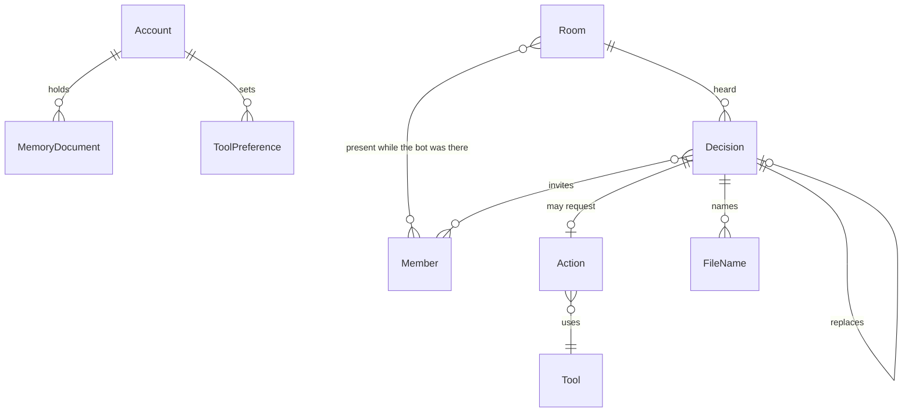

# Design: Entities

**Status:** active
**Owner:** @ngna3007
**Last updated:** 2026-10-21
**Scope:** System-wide

The record is a set of memory documents in a MemWal account. A file's bytes are a Console object named by a decision. Nothing below is a table in a second database.

## Account

The company account and the personal account. Each is one MemWal account, so each has its own Sui address. The address and the account id are never rendered and never logged.

| Field | Rule |
|---|---|
| kind | `company` or `personal` |
| memwalAccountId | Used by the adapter. Not a member-facing value |
| delegateKey | Held by the process for this account. The owner key is absent |

A namespace is a label inside the account, fixed as `sederunt`. It does not separate members.

## Operator

The person who owns both accounts. They are not a stored row. They prove ownership on Walrus Memory, outside this process, and register the delegate key there. They choose a tool's preference by an utterance the gate stores as a `ToolPreference`.

## Member

A person in a room, identified by the platform.

| Field | Rule |
|---|---|
| id | Recall participant id, or the channel user id. Stable for that room. Not a display name |
| displayName | Label only. Two people can share one |
| roomId | The room that issued the id |

Sederunt does not merge a person across rooms. The same human in two meetings is two member ids.

## Room

A meeting or a channel.

| Field | Rule |
|---|---|
| id | Assigned by the gate |
| kind | `meeting` or `channel` |
| source | `recall` or the channel platform |
| sourceId | Bot id or channel id |
| title | The name people used, such as "Client call" |
| memberIds | People present while the bot was in the room |
| botPresent | Must be true before a decision from this room is stored |

Zoom, Google Meet, Teams, and Webex are meeting sources. A Slack huddle is not. A channel is a room whose members are the channel's members, and only when the bot was in the channel.

## MemoryDocument

The persisted envelope. `remember` stores it as text. `recall` returns it to the gate. The member hears the sentence, not the envelope.

| Field | Rule |
|---|---|
| kind | `decision`, `preference`, or `action` |
| account | `company` or `personal` |
| idempotencyKey | At most 255 bytes. A repeat of the same key does not store a second copy |
| checkpoint | Not trusted from inside the text. The stamp is the checkpoint of the write, read through Tatum |

`analyze` is used only for long text, and it extracts facts. It is not how a file is stored. A bulk write holds at most 20 documents.

## Decision

What was heard.

| Field | Rule |
|---|---|
| id | Stable id from the gate |
| roomId | Required |
| text | The sentence |
| speakerMemberId | Who said it |
| inviteMemberIds | Copy of the room's member ids at that moment. Later joins do not enter it. Later departures do not leave it |
| area | Groups contradictions, such as one piece of work |
| contradicts | Ids of decisions this one conflicts with |
| predecessorId | The decision this one follows, when there is one |
| replaces | The id this one replaces, when it is a replacement |
| replacedBy | Set when a later decision replaces this one. The text stays |
| blobId | Present once the relayer job is done |
| expiryEpoch | Observed from the blob, so the operator can see age. This process does not extend the blob |
| fileNames | Names of Console files. Not the bytes |

A private utterance (`private:` or `private note:`) is a decision on the personal account. Its invite set is the speaker.

Clash is a pure function of these fields. A decision with `replacedBy` is `replaced` and stays visible. Two decisions that list each other in `contradicts`, and are not replaced, are both `clashing`. Newest does not win. A decision with no predecessor and no live contradiction is `current`. Otherwise a stored decision is `recorded`.

## Tool

A connected outside system.

| Field | Rule |
|---|---|
| id | `linear` or `calendar` |
| reads | Operations that do not change the tool |
| writes | Operations that do |

Linear's write returns an issue id. Calendar's write returns an event id. The Recall calendar API sends the bot. It is not the edit path. The live Calendar MCP tool list is read before a write tool is named in code.

## ToolPreference

Stored with the account as a memory document of kind `preference`.

| Field | Rule |
|---|---|
| tool | The tool id |
| value | `ask` or `do` |
| roomId | Empty for the account default. Set when a room overrides the account |
| replacedBy | The newer preference for the same tool and room. The old one stays visible |

The live preference is the one without `replacedBy`. A missing preference means `ask`. The room override wins over the account default for decisions in that room. Changing `do` to `ask` replaces the preference. The next action stops before the connector call.

## Delivery

One utterance arriving at the gate.

| Field | Rule |
|---|---|
| id | Transcript segment id, or the client submission id |
| door | `meeting`, `channel`, or `mcp` |
| roomId | The room the utterance is about |
| memberId | Required |
| text | The words |

A second arrival with the same delivery id is `duplicate-delivery`.

## Action

A requested write. Stored as a memory document of kind `action` so a restart still knows it.

| Field | Rule |
|---|---|
| id | Stable id |
| deliveryId | The delivery that created it |
| roomId | Where it was requested |
| memberId | Who requested it |
| tool | The tool id |
| preference | The live preference at request time |
| statement | The one action, in words |
| params | The connector input. No invented fields |
| missingFact | Set when a required fact is absent. The connector is not called |
| connectorId | Null until the connector returns one |
| edit | `create` or `update` |

States:

| State | When |
|---|---|
| `waiting` | Preference is `ask`, facts are complete, and no confirmation has arrived |
| `dismissed` | The member dismissed the waiting action |
| `available` | The connector was called and returned no id, or the call failed |
| `closed` | `connectorId` is set |

`ask` creates the action in `waiting` and does not call. Confirmation of that action moves it to the call. `do` does not wait. The gate calls as part of handling the delivery. There is no waiting row the member must confirm.

`filed` means `edit` is `create` and `connectorId` is set. `updated` means `edit` is `update` and `connectorId` is set. Without an id the status stays `recorded` and the state stays `available` after a failed call.

## FileName

A pointer from a decision to a Console file.

| Field | Rule |
|---|---|
| name | The name in the decision sentence |
| consoleFileId | Present after a completed upload |
| folderId | The private folder |

Recall returns the sentence. The bytes stay in the folder. Console renews the file.

## Proof

A read, not a stored document.

| Field | Rule |
|---|---|
| blobId | The blob the decision names |
| checkpoint | The sequence Tatum returns |
| preference | The preference in effect for the action, when the proof is about an action |
| status | The domain status, or `unknown` when Tatum fails |

The proof shows the checkpoint and the preference. It does not show an account id or a key. An explorer link may open on the object. When the recalled text and the object disagree, the object is the answer.

## What is not an entity

- A Sederunt user, session cookie, or password.
- A wallet account or a sponsored-transaction record.
- A `/record` page or a form on the landing.
- A SQL row. A process-local index of invite sets and delivery ids is a cache. Reading the account rebuilds it.

## Links

- Requirements: [docs/requirements/sederunt.md](../requirements/sederunt.md) — SED-1 through SED-7
- Decisions: [0002](../decisions/0002-two-accounts.md), [0003](../decisions/0003-room-membership.md), [0004](../decisions/0004-write-preference.md), [0005](../decisions/0005-walrus-is-the-record.md)
- System: [docs/design/system.md](./system.md)
