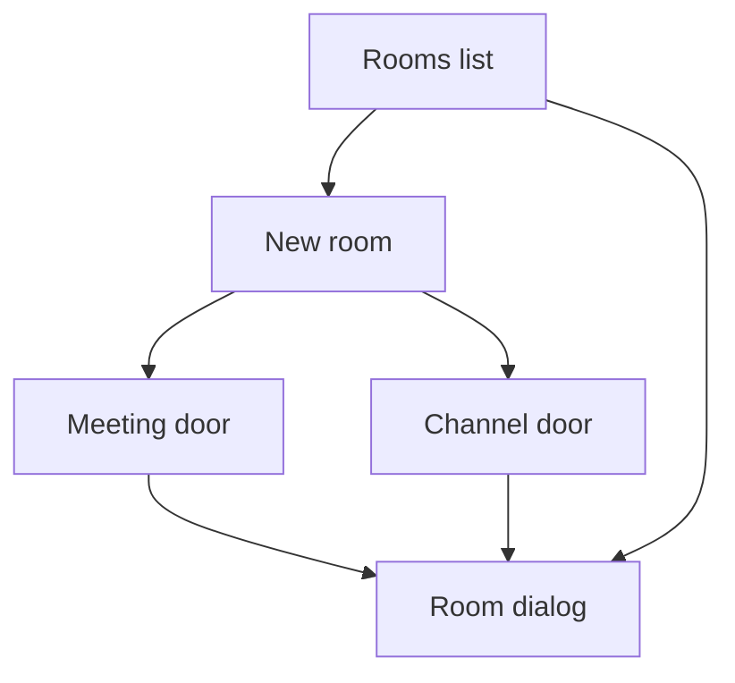

# Design: Rooms

**Status:** draft
**Owner:** @ngna3007
**Last updated:** 2026-10-23
**Scope:** Feature-level. How an operator brings the bot into a room, and what the room dialog shows after that.

## Mission

A room is a meeting or a channel the bot was in. The operator does not name it and does not type the people. The platform does. This surface shows the room that resulted, and refuses a door the bot cannot speak in.

## Design Principles

- Two doors, and no third. A meeting link, or a channel the bot is already in.
- The dialog does not ask for a room name, a typed member list, or an account.
- The title, the kind, and the people present are facts from the room. The dialog does not edit them.
- A decision is stored only when the bot was in the room. The invite set is the people present at that moment. Later joins are not added. Leavers stay.
- The bot stays quiet until someone addresses it.
- A personal workspace has no control for a new room. A private note is not a room.
- A Slack huddle is not a meeting and not a channel.

## Architecture

The list and the dialog live in the workspace shell from [workspace.md](./workspace.md). Creating a room does not create a workspace, and switching workspace closes this dialog.

### Rooms list

Each room is one block in a grid. The list is not a table and not a row. The mark sits beside the title. Under the title is where the room is: the platform name, and the channel when the room is a channel. The bottom line shows who was present, as faces. Each display name keeps one color. The bot is its own face beside the name Sederunt. That face is not the app mark. The last decision is the lead of the dialog, not a line on the block. A block has no preview area. It does not carry a transcript, a file name, a waiting list, or a meeting link. Those stay in the dialog.

The types are Google Meet, Zoom, Teams, Webex, and Slack. A channel block names the channel, such as #design. A meeting block has no channel, because a meeting is not a channel. The page line "Present while the bot was there" is what the names on the bottom line mean.

A company workspace shows New room. A personal workspace does not. An empty company list says to bring the bot into a meeting or a channel. An empty personal list says a private note is not a room.

A block opens the room dialog. The list does not grow a side pane.

### New room

The button opens a dialog over the list. Close is the X at the top right, the shade, or Escape. Two choices sit side by side:

1. Meeting. One field: the link. The accepted hosts are Zoom, Google Meet, Teams, and Webex. Join with this link is the only submit.
2. Channel. No field. The copy states that a channel becomes a room when the bot is already in it, names the channels that already are rooms, and says a Slack huddle is the voice call, not this door.

There is no name field and no people field.

#### Meeting door

| Input | Result |
|---|---|
| Empty | "Paste a Zoom, Google Meet, Teams, or Webex link." The dialog stays open |
| A Slack host, or a link that says huddle | "A Slack huddle is not a meeting. Add the bot to the channel." The dialog stays open |
| Any other host | "That link is not Zoom, Google Meet, Teams, or Webex." The dialog stays open |
| An accepted host | The dialog closes. A block appears with the title "Waiting for the meeting name", kind meeting, the platform taken from the host, no channel, no people yet, and "No decision yet." |

The block does not use the link as the title. The meeting names the room when the bot is in it. Until then the title says it is waiting. People appear for whoever is present while the bot is there. The link is not rendered back, so a query secret on the URL is not shown. The company account keeps the room, without the link, so the block remains after a reload. A failed join leaves no room.

The bot joins with camera and microphone through the meeting door and stays quiet until addressed. A failed join leaves no decision. The typed door can still carry a delivery, as [access.md](./access.md) already says.

#### Channel door

A channel is a room whose members are the channel's members, and only when the bot was in the channel. The operator adds the bot in the channel's own product. This dialog does not pretend to add it. When the bot is in a channel, the block appears with that channel's name and the members at that moment.

Slack enters here, as a channel. The huddle inside Slack does not.

### People

The operator who uses New room does not own the room, and does not type its members. The company workspace holds the room. The file may say who brought the bot in. That line is a fact. It is not a role, and it does not grant a separate permission. If that person leaves the company, the room stays. A personal workspace still has no New room control.

The platform fills two lists. They are not one list.

Present is who the platform reports in the meeting or the channel while the bot is there. The card shows those people as faces. A meeting that has not reported anyone says "No one is recorded yet." There is no control for adding a person. A name typed here would not put them in Zoom, Google Meet, Teams, Webex, or Slack, and a person added by hand could be shown a sentence they were not present for.

Heard on a decision is a copy of who was present when that decision was kept. Someone who joins later is not added. Someone who leaves stays on that decision. The faces on the card can change with who is there now. They do not rewrite an older decision.

A channel takes members from that channel, at the moment the bot looks, and only while the bot is in it. The product does not copy the whole Slack workspace. A meeting does not import the calendar invite. A person who was invited and did not join is not present.

The bot's face sits on the same line as the people. The bot is not a member of the invite set. If the platform has not sent who is there, the file says "The meeting has not sent who is there." The operator can try the read again. That failure does not open a field for names.

### Room dialog

One click opens the file for that room. The title is the room's title. The kind is meeting or channel.

The body, hiding any block that is empty:

1. The last decision, or "No decision yet." This line leads. It is heavier than the rows under it.
2. "Heard by" and the display names present while the bot was there. If none are stored, "No one is recorded yet."
3. The room's write preference, as a switch labeled Ask first. On, this room waits before a change. Off, this room sends the change. The switch overrides the account preference for this room only. A new room starts on.
4. The room's voice, copied from a preset onto this room only. The presets are Short, Plain, and Formal. Short is one sentence. Plain is the decision and who heard it. Formal is those, plus the ask when something is waiting. Copying a preset does not change another room, and it does not change Ask first. There is no custom prompt. The bot name stays Sederunt.
5. Raise a clash, as its own switch. It starts off. When it is on, the room raises the clash in the room. A Slack channel can instead send a direct message. A Zoom, Google Meet, Teams, or Webex room cannot. Both clash sentences stay visible. The switch does not pick a winner. Changing it does not change Ask first or the voice, except when a preset copies a voice and a clash delivery together.
6. Decisions kept. Each sentence is a row that opens that decision's own dialog, with its state word beside it. The sentence that leads this file is not listed again. A clash shows both sentences. A replaced sentence stays reachable from the decision dialog.
7. Waiting. Each waiting change is a row that opens that change, where Confirm and Dismiss apply to that change only. If none, "No change is waiting in this room."
8. The file name, when a decision names one, on its own tile with a mark for that file type. Several files sit in one row. No size, no bytes, no open action.
9. Not invited. Who asked, and that no sentence is shown. The decision text is absent.

The dialog does not show an account id, a key, a token, a namespace, or the raw member id. Display names are labels.

## Cross-Cutting Concerns

### Security

#### Assumptions

- The meeting platform reports a stable participant id for the length of that meeting. A display name is not that id.
- The same person in two meetings may be two member ids. This surface does not merge them.

#### Known Gaps and Risks

| Gap | Severity | Impact | Root Cause | Mitigation |
|---|---|---|---|---|
| A pasted link can carry a secret in the query | medium | The secret would show if the UI echoed the URL | Meeting links are bearer-shaped | The UI checks the host and does not render the URL |
| A channel list from the platform can be stale | low | A row appears for a channel the bot has left | Membership is observed at a moment | `botPresent` false produces no new decision. The stored invite set does not shrink |

#### Controls

- Invite check is unchanged: an absent member id returns not-invited and no sentence. The room dialog uses that same refusal. The company account keeps who asked, without the sentence, so the line remains after a new process. A missing member, a room with no notes, and a huddle store nothing.
- The company delegate is not used from this surface. A write still goes through the gate after an allow.

## Constraints

- [0003](../decisions/0003-room-membership.md): the room's member id is the authorization.
- [0002](../decisions/0002-two-accounts.md): company rooms and the personal note are different accounts.
- Requirements non-goal: Slack huddles. The meeting door is Zoom, Google Meet, Teams, and Webex.
- [entities.md](./entities.md): `botPresent` must be true before a decision from the room is stored. `memberIds` are the people present while the bot was there.

## Acceptance Criteria

| Requirement | Satisfied by |
|---|---|
| SED-1.1 | Rooms list, the two doors |
| SED-1.2 | Meeting door, Channel door |
| SED-1.3 | The fact line on each block, who was present |
| SED-1.4 | The meeting door. The bot stays quiet until addressed |
| SED-3.1 | Security, display names are labels |
| SED-3.2 | Not invited |
| SED-7.4 | The dialog omits account ids |

## Open Points

- The requirements name the meeting platforms and refuse huddles. They call the other door "the channel platform" without a fixed list. Slack is the channel discussed so far. Another channel product needs a decision before it becomes a door.
- "Waiting for the meeting name" is the title until the platform sends one. What the block shows if the platform never sends a title is open.

## Links

- Requirements: [docs/requirements/sederunt.md](../requirements/sederunt.md)
- Decisions: [0003](../decisions/0003-room-membership.md), [0002](../decisions/0002-two-accounts.md)
- System: [docs/design/system.md](./system.md)
- Workspace: [docs/design/workspace.md](./workspace.md)
- Entities: [docs/design/entities.md](./entities.md)
- Access: [docs/design/access.md](./access.md)
