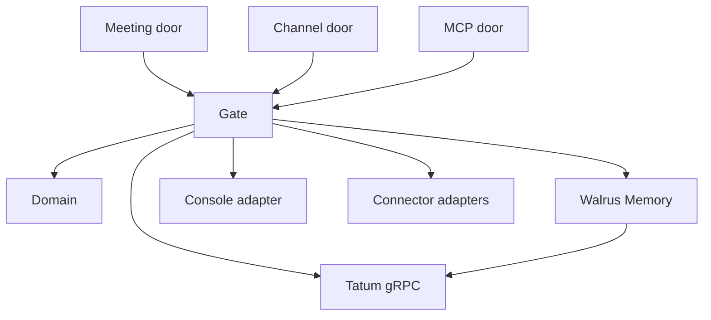

# Design: System

**Status:** active
**Owner:** @ngna3007
**Last updated:** 2026-11-04
**Scope:** System-wide

## Mission

Sederunt joins a meeting or a channel, keeps the decision, and answers later from the agent a member already uses. A requested change in a connected tool follows that tool's preference.

The public landing explains the product. It is not a door into the record. There is no `/record` page.

## Design Principles

- One gate writes. Doors deliver utterances. They do not call Linear, Calendar, Memory, or Console themselves.
- The room's member id is the authorization. Display names are labels.
- The sentence in Walrus Memory is the record. A file stays in Walrus Console. The Sui object, read through Tatum, wins a disagreement.
- A missing fact stops an action. The agent does not invent one.
- Secrets stay out of answers, the landing, and the log. Account ids are secrets.

## Tech Stack

| Layer | Technology | Notes |
|---|---|---|
| Runtime | Node 20+ | One ESM process, `node src/server.js` |
| Language | JavaScript | Domain is plain functions. Remotion clips are TypeScript and are not a dependency of the server |
| Record | Walrus Memory | `@mysten-incubation/memwal` against `https://relayer.memory.walrus.xyz` |
| Files | Walrus Console | Private Seal folder. API at `api.console.walrus.xyz` |
| Proof and locate | Tatum | Native gRPC at `https://sui-mainnet-grpc.gateway.tatum.io:443` with `x-api-key`. `GetObject`, `ListOwnedObjects`, `GetTransaction`, `GetCheckpoint`, and `GetServiceInfo`. No public GraphQL and no public fullnode |
| Meetings | Recall.ai | Output Media bot. Zoom, Google Meet, Teams, Webex |
| Connectors | Remote MCP | Linear at `https://mcp.linear.app/mcp`. Calendar is read from its live tool list before a write tool is named |
| Agent door | Sederunt MCP | Local stdio. Tools are `recall` and `act` |
| Landing | HTML from `src/landing.js` | Three.js from jsDelivr `three@0.183.0`. No React, Next, Hono, GSAP, or Tailwind on this server |

## Architecture

Imports point downward. `src/domain/` imports nothing else under `src/`. The gate imports the domain and receives adapters. An adapter imports its SDK. The landing renders a string. It does not call the gate.

### Domain

Pure rules: invite check, write preference, status, clash, and checkpoint. Given the same inputs, they return the same outputs. They do not read the network.

### Gate

`handleUtterance` is the write door. It resolves the caller, checks the invite set, parses the utterance, applies the tool preference, and then calls at most one adapter. A delivery id that already has an action does not call again.

### Adapters

| Adapter | Owns | Failure |
|---|---|---|
| Memory | `remember`, `recall`, `analyze` on one account per call | The decision is not stored. The gate does not invent a blob id |
| Console | Upload and name a file in a private folder | The decision can still be stored. It does not claim the file exists |
| Tatum | Read and locate the Blob object, its certifying transaction, and the chain tip | Status `unknown`. No GraphQL and no public-fullnode fallback |
| Connector | One tool operation | No id comes back. The action stays available |
| Recall | Join, transcript, participant ids | The typed MCP door still accepts a delivery |

### Landing

`renderLanding()` is the page at `/`. Clips are files under `public/clips/`. The favicon is `public/favicon.svg`. The page does not post and does not link to a record screen.

## External Dependencies

- Walrus Memory public relayer — stores the sentence. The relayer's server wallet pays WAL and SUI. The relayer sees plaintext. There is no SLA.
- Walrus Console — stores file bytes and sponsors the folder transaction. The service key signs the sponsored bytes and posts the signature. It holds no SUI balance for that transaction.
- Tatum gRPC — reads the object. A failure is `unknown`.
- Recall.ai — bills from join, including time in a waiting room. The bot page must be publicly reachable. Meeting audio comes from the stream Recall grants, so the bot does not hear itself.
- Linear and Calendar MCP — outbound tools. Tokens stay in the adapter.

## Cross-Cutting Concerns

### Security

#### Assumptions

- The operator registered the delegate key, and the owner key is not on this machine's server environment.
- A member id from Recall or the channel platform is the same id the decision stored.

#### Known Gaps and Risks

| Gap | Severity | Impact | Root Cause | Mitigation / Acceptance |
|---|---|---|---|---|
| Delegate key decrypts the whole account | high | A leaked key reads every namespace on that account | MemWal delegate access is account-wide | One key per account on the server. Members never receive it. Removal of the key stops later relayer use |
| Public relayer sees plaintext | high | The operator trusts the Walrus Foundation host | Managed relayer encrypts on the server | Accepted for this deployment. A self-hosted relayer is the same gate with a different `serverUrl` |
| Local MCP config member id is not a secret | medium | Someone who can run the process can present that id | The key, not the id, decrypts | The invite check protects the doors. Direct relayer access still requires the delegate key |

#### Controls

- Invite check before any sentence leaves the gate.
- Closed error codes. A response body is not `error.message`.
- Log lines carry door, room id, member id, tool, preference, result, and connector id. They omit the sentence, keys, tokens, and account ids.
- Landing HTML is `no-store`. Clip files may be cached for an hour.

### Data Architecture

There is no application database. The memory document is the record. See [Entities](./entities.md) and [Record](./record.md).

### Error Handling and Resilience

The gate returns a code from this set:

| Code | Meaning |
|---|---|
| `missing-member` | The caller presented no member id |
| `not-invited` | The member id is not on this decision |
| `missing-fact` | The action needs a fact that was not in the request |
| `preference-waiting` | The tool is `ask`, and the action is stated |
| `connector-failed` | The connector returned no id. The action remains available |
| `duplicate-delivery` | This delivery id was already handled |
| `unknown-proof` | Tatum did not return the object |
| `invalid-checkpoint` | The checkpoint is not a non-negative integer |
| `late-checkpoint` | The checkpoint is later than the checkpoint at which the result was knowable |
| `relayer-rejected` | Memory or Console refused the call |

`filed` and `updated` exist only together with a connector id. The other visible statuses are `recorded`, `current`, `clashing`, `replaced`, and `unknown`.

### Observability

One stdout line per gate decision. A restart loses the line and keeps the Walrus record.

## Constraints

- [0001](../decisions/0001-one-process.md) — one process, one gate.
- [0002](../decisions/0002-two-accounts.md) — company and personal are two accounts.
- [0003](../decisions/0003-room-membership.md) — no member login.
- [0004](../decisions/0004-write-preference.md) — ask or do, per tool.
- [0005](../decisions/0005-walrus-is-the-record.md) — no second database, no sponsor we operate.

## Links

- Requirements: [docs/requirements/sederunt.md](../requirements/sederunt.md)
- Decisions: [docs/decisions/](../decisions/)
- Entities: [docs/design/entities.md](./entities.md)
- Access: [docs/design/access.md](./access.md)
- Record: [docs/design/record.md](./record.md)
- Actions: [docs/design/actions.md](./actions.md)
- Workspace: [docs/design/workspace.md](./workspace.md)
- Rooms: [docs/design/rooms.md](./rooms.md)
