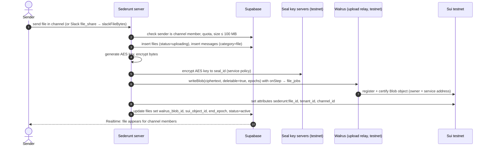
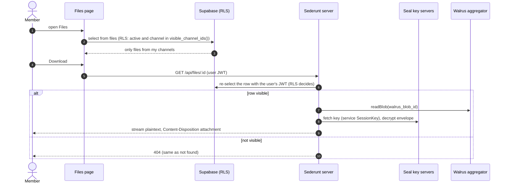
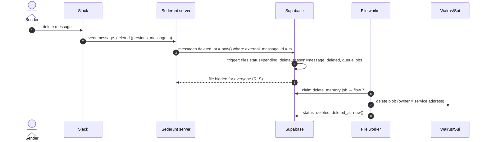
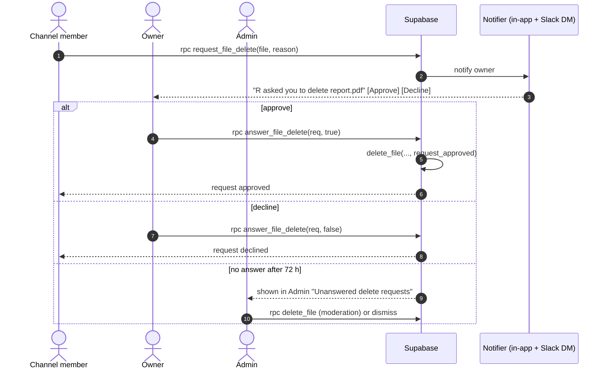
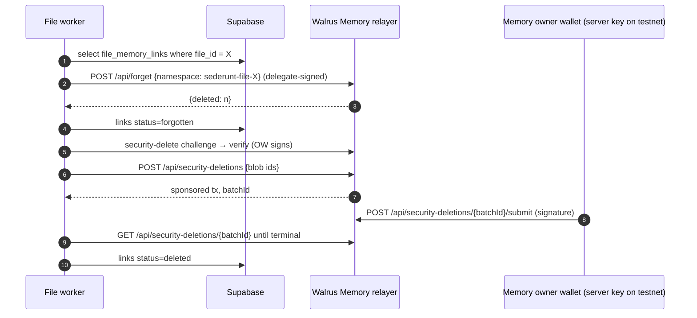

# Design: Files on Walrus

**Status:** building
**Owner:** @ngna3007
**Last updated:** 2026-11-04
**Scope:** Feature-level. How a file sent in a Sederunt channel is stored, shown, deleted, and forgotten.

Upstream: [system.md](./system.md), [rooms.md](./rooms.md), [access.md](./access.md), ADR [0003 room membership](../decisions/0003-room-membership.md), ADR [0005 Walrus is the record](../decisions/0005-walrus-is-the-record.md).
Code it builds on: `supabase/migrations/2026110319*` (tenants, memberships, channels, channel_members, messages, `private.*` helpers), `src/slack/reply.js` (`slackFileBytes`), `src/server.js` (`/api/slack`, `file_share` and `message_deleted` subtypes), `src/console/upload.js` (Seal + Console), `src/memory/company.js` (Walrus Memory).

## What was built

Testnet only. The service wallet owns every blob (`deletable: true`, never permanent or shared). Files follow current channel membership. An admin who removes a file deletes the blob. Unanswered delete requests show to admins after 72 hours.

**Seal (option A).** `move/sederunt_files` publishes `policy::seal_approve`, which accepts only the service address stored on the shared `Service` object. Published on Sui testnet:

- Package `0x35f30738d39af36248cc2cd6bea82be2d5840df760d7f53e63bc46ba5cbb4c34` — https://suiscan.xyz/testnet/object/0x35f30738d39af36248cc2cd6bea82be2d5840df760d7f53e63bc46ba5cbb4c34
- Service `0x80f305b6fcbd3a931404ae472ad31bb4b1af391dfae1b0432a92290d2f635a2e` — https://suiscan.xyz/testnet/object/0x80f305b6fcbd3a931404ae472ad31bb4b1af391dfae1b0432a92290d2f635a2e
- Publish transaction `9L7YKB3Eneua2aT4DwuSXVxrUrebgBrwREXSbevRX9Ps` — https://suiscan.xyz/testnet/tx/9L7YKB3Eneua2aT4DwuSXVxrUrebgBrwREXSbevRX9Ps

The file bytes are AES-256-GCM. Seal encrypts only the 32-byte AES key, using the Mysten open-mode testnet key servers at threshold 1. The AES key is not written to Postgres. Demo and tests pass no Seal client, so they wrap that key with a server secret instead. A live Seal encrypt and decrypt against the key servers succeeded before the Walrus upload.

**Walrus.** `@mysten/walrus` on testnet, upload relay `https://upload-relay.testnet.walrus.space`, `writeBlob` with `deletable: true`, and attributes `sederunt:file_id`, `sederunt:tenant_id`, `sederunt:channel_id`. Retryable Walrus errors reset the client and try again. Direct storage-node reads from this host do not get a quorum, so a read falls back to the testnet aggregator `https://aggregator.walrus-testnet.walrus.space`. Already-deleted blobs count as a successful delete.

**App.** `src/files/` uploads, downloads, and deletes through an injectable store. A non-member gets 404. The owner or an admin hides the row immediately and queues `delete_blob` and `delete_memory`. Another member can ask the owner to delete. The worker backs off from 1 minute to 6 hours and stops after 12 failures. Slack `file_share` is ingested when the channel is bound, and `message_deleted` hides the file.

**Memory.** One namespace per file, `sederunt-file-<id>`. Forget and Security Delete run only when a Sederunt Walrus Memory account is configured. Without `SEDERUNT_MEMWAL_KEY`, `SEDERUNT_MEMWAL_ACCOUNT_ID`, and `SEDERUNT_MEMWAL_OWNER_KEY`, the worker records the link and marks that step skipped. It does not report the namespace as forgotten.

**Database.** `supabase/migrations/20261104210000_files.sql` adds `files`, `file_delete_requests`, `file_memory_links`, and `file_jobs`, plus RLS and the private definer RPCs. It is not applied. Until it is, the Node process uses its in-memory store. The SQL job claim uses `for update skip locked` and is not granted to `authenticated`. `supabase/tests/rls_tests.sql` covers member read, ex-member, other tenant, owner delete, admin delete, member denial, request and approve, the 72 hour admin list, and pending rows hidden from other people.

**Console.** Files is a nav item. The page groups files by channel and shows owner, size, and date. The menu is Download, Delete for the owner or an admin, and Ask owner to delete for anyone else. A pending file shows Deleting…. The owner sees incoming requests. An admin sees Unanswered delete requests older than 72 hours. Screenshots: `docs/pr-screens/files-*.png`.

### Environment names

Values stay in the server environment. The names are:

`WALRUS_NETWORK`, `WALRUS_SERVICE_KEY`, `WALRUS_SERVICE_ADDRESS`, `WALRUS_FILE_EPOCHS`, `SEAL_PACKAGE_ID`, `SEAL_SERVICE_OBJECT_ID`, `FILES_WRAP_KEY`, `SEDERUNT_MEMWAL_KEY`, `SEDERUNT_MEMWAL_ACCOUNT_ID`, `SEDERUNT_MEMWAL_OWNER_KEY`, `SEDERUNT_MEMWAL_SERVER`, `FILES_DEMO`.

`WALRUS_NETWORK` must be `testnet`. `FILES_DEMO=1` uses the in-memory store and never spends gas.

### Live proof

`scripts/walrus-live-proof.mjs` sealed a small text file, stored it with `writeBlob` (`deletable: true`, 1 epoch) through the upload relay, read it back, and deleted it. SHA-256 matched. The full record is `docs/files-live-proof.json`.

- Run 2026-11-04T15:49:05.566Z (UTC), encryption `seal` (Seal testnet key servers, AES-256-GCM body)
- Blob `NwHYGQhE2LpAzI4iN0vURy73E4buG5NaDKtrKrmtXOM`
- Object `0xd36e03f1cbb22502d1b7302f0c2e541a8f8cab122a922585132a10398beb1431` — https://suiscan.xyz/testnet/object/0xd36e03f1cbb22502d1b7302f0c2e541a8f8cab122a922585132a10398beb1431
- Register `DejycKHGfZ7DP3z6TXfLAGBQBgHmwg5kDRHFEbVgXLYt` — https://suiscan.xyz/testnet/tx/DejycKHGfZ7DP3z6TXfLAGBQBgHmwg5kDRHFEbVgXLYt
- Certify `7v6xJfXZYHF5BYt58xCRMhCxMZytK4PN4U9tsPmzkVq5` — https://suiscan.xyz/testnet/tx/7v6xJfXZYHF5BYt58xCRMhCxMZytK4PN4U9tsPmzkVq5
- Delete `FBkaAe2EnQdy6XHdAhnWHTwahT4A53SjWyFpHacmcpkV` — https://suiscan.xyz/testnet/tx/FBkaAe2EnQdy6XHdAhnWHTwahT4A53SjWyFpHacmcpkV
- End epoch 572

The read used the testnet aggregator after storage nodes returned no metadata. `walrus blob-status` before delete did not get a node quorum in five tries over about a minute; the Sui Blob object was present then (`objectBeforeDelete` in the JSON). After delete it reported `"status": "nonexistent"`, and the Sui object was not found. The aggregator still returned HTTP 200, which is its cache (`max-age=86400`), not the Blob object.

## Mission

A file sent in a channel belongs to the person who sent it, can be seen by the people in that channel and nobody else, and can be made to disappear: from the app at once, from Walrus soon after, and from the agent's memory too.

## Design principles

- **Sederunt decides access; Walrus stores bytes.** Walrus blobs are public and discoverable ([managing blobs](https://docs.wal.app/docs/walrus-client/managing-blobs)), so every blob is Seal ciphertext and the access decision lives in Supabase RLS, which already gates channels and messages.
- **The sender owns the file.** Ownership is a Supabase fact (`files.owner_user_id`). On chain, the Blob object is held by Sederunt's service address, because Sederunt users sign in with Google/GitHub and have no Sui wallet (see "Who owns the Blob object").
- **Always deletable.** Every blob is stored with `deletable: true`. A permanent blob cannot be deleted before expiry, and shared blobs can only hold permanent blobs ([managing blobs](https://docs.wal.app/docs/walrus-client/managing-blobs)). So we never use `--permanent` or `share`.
- **Hide first, delete after.** A delete flips the row to `pending_delete` in one transaction (hidden for everyone by RLS), then a job does the slow, retryable chain work.
- **No orphan memories.** Every Walrus Memory write about a file carries the file id, and file deletion deletes those memories.
- **Testnet and free tiers until the user says otherwise.**

## How this fits ADR 0005

ADR 0005 says Walrus is the record and Postgres is only a rebuildable index. `files` follows that: the bytes and the Blob object are on Walrus/Sui, and the row is an index of them plus access state. To keep it rebuildable, each Blob object gets attributes `sederunt:file_id`, `sederunt:tenant_id`, `sederunt:channel_id` (Walrus blob attributes, [managing blobs](https://docs.wal.app/docs/walrus-client/managing-blobs#set-blob-attributes)). Walking the service address's Blob objects rebuilds the index. Two things are new, and ADR 0005 is amended for them (decided): access state (who may read, delete requests) lives only in Postgres, and Sederunt holds its own funded testnet wallet that owns and pays for file blobs.

## Today's code (what this builds on)

| Piece | Where | Relevance |
| --- | --- | --- |
| Workspaces | `public.tenants` (`personal` / `team` / `company`) | `files.tenant_id`. Personal tenants have one member. |
| Roles | `public.memberships.role` in `owner`, `admin`, `member` | Owner/Admin = moderation. |
| Helpers | `private.user_tenant_ids()`, `private.admin_tenant_ids()`, `private.visible_channel_ids()` (security definer, `search_path=''`) | Reused in file RLS. |
| Channels | `public.channels` (`visibility` `invited`/`tenant`), `public.channel_members` (FK cascades when tenant membership is removed), `public.channel_bindings` (Slack etc.) | "Leaving the channel" = row removed from `channel_members` (or tenant). |
| Messages | `public.messages` (`category` includes `file`, `external_message_id` = Slack `ts`, `deleted_at`, `memory_blob_id`) | `files.message_id` FK. Message delete already sets `deleted_at`. |
| Slack ingest | `/api/slack`: `file_share` and `message_deleted` subtypes pass the noise filter; `slackFileBytes()` downloads with the bot token | Upload and message-delete triggers for Slack. |
| Seal | `src/console/upload.js` already uses `@mysten/seal` (`SealClient`, `SessionKey`) for Console private folders, on mainnet | Reuse the pattern, but point it at testnet and our own policy. |
| Memory | `src/memory/company.js` uses `@mysten-incubation/memwal`, namespace `sederunt`, delegate key | Memory link + cleanup. |

Note: `messages_select` today requires `invite_user_ids @> [me]` (ADR 0003: you see what you were present for). Files deliberately use **current channel membership** instead, per the agreed design ("leaving the channel revokes access"). **Decided:** files follow current channel membership. People who leave lose access; people who join later can see older files (but not the older messages they came with, which still follow ADR 0003).

## Storage and encryption

### Writing a blob

Server side, with `@mysten/walrus` on testnet ([TS SDK](https://sdk.mystenlabs.com/walrus)):

```js
const client = new SuiGrpcClient({ network: "testnet", baseUrl: "https://fullnode.testnet.sui.io:443" })
  .$extend(walrus({ uploadRelay: { host: "https://upload-relay.testnet.walrus.space", sendTip: { max: 1_000 } } }));
const result = await client.walrus.writeBlob({
  blob: ciphertext, deletable: true, epochs: EPOCHS, signer: serviceKeypair,
  onStep: (step) => saveStep(fileId, step),      // crash-recoverable
  resume: await loadStep(fileId),
});
```

`writeBlob` (not `writeFiles`) because one file per blob keeps delete per-file; `writeFiles` packs files into one quilt, and deleting a quilt deletes all of them. The upload relay cuts ~2,200 storage-node requests to one, for a small SUI tip (testnet SUI from the faucet). The signer pays SUI gas and WAL storage ([TS SDK](https://sdk.mystenlabs.com/walrus#writing-files)).

### Seal: server-side vs client-side

Seal encrypts to an identity; key servers release the key only if a `seal_approve*` Move function approves the caller ([Using Seal](https://seal-docs.wal.app/UsingSeal/)). Large files should use envelope encryption: AES the bytes, Seal-encrypt only the AES key ([Using Seal, performance](https://seal-docs.wal.app/UsingSeal/#optimizing-performance)).

| | **A. Server-side (service key)** | **B. Client-side (per-user Sui address)** |
| --- | --- | --- |
| Who encrypts/decrypts | Sederunt server, with its service address | Each user's browser, with a zkLogin/Enoki address |
| `seal_approve` checks | caller == Sederunt service address (or an allowlist containing only it) | caller is in an on-chain allowlist object per channel |
| Access source of truth | Supabase RLS (already exists, already tested) | On-chain allowlist that must mirror `channel_members` |
| Revocation on leave | Immediate: RLS stops the download route | Needs an allowlist tx per leave, and propagation is not atomic across key servers ([Seal limitations](https://seal-docs.wal.app/UsingSeal/#limitations)) |
| What a leaver keeps | Nothing from Sederunt; they never had a key | Any key already fetched keeps decrypting ([Using Seal](https://seal-docs.wal.app/UsingSeal/): "Fetched keys can be used for future decryptions") |
| Server sees plaintext | Yes, briefly, while streaming | No |
| Wallet/gas UX | None for users | Users need a Sui address; sign a SessionKey; key-server rate limits |
| Cost | Service pays everything | Same storage cost; plus allowlist gas |

**Recommendation: A for v1.** It matches how Sederunt already works (the server holds the Slack bot token and reads message bodies), keeps one access model (RLS), and revokes instantly. Seal's job in A is narrow and important: anyone who pulls the blob straight from Walrus gets ciphertext. B is the end-to-end option for later if "the server can't read files" becomes a requirement (default kept: A for v1). The service key lives only in server env (never in the repo, never logged), and the AES data key is never stored in Postgres; only the Seal-encrypted envelope header travels with the blob.

### Who owns the Blob object

Only the owner of the Blob object can delete or extend an owned blob ([managing blobs](https://docs.wal.app/docs/walrus-client/managing-blobs#how-to-delete-blobs)). Users have no wallets, so the service address owns every Blob object and enforces "sender owns the file" in code. If option B arrives, a blob could be transferred to the sender's address, but then Sederunt could no longer moderate-delete it. Keeping the service as on-chain owner is what makes admin removal possible.

### Who pays and how blobs are renewed

- **Testnet (now):** the service address is funded from the Sui testnet faucet and testnet WAL (`walrus get-wal`). Cost is zero real money.
- **Mainnet (later, needs the user):** the workspace pays, and Sederunt fronts WAL/SUI. Per-workspace quota: `tenants.storage_quota_bytes` (sum of active `files.size_bytes`), default small; reject uploads over quota. Billing is out of scope for now (default kept: Sederunt fronts testnet cost; mainnet payment decided before leaving testnet).
- **Lifetime:** store for `EPOCHS` (configurable; testnet epochs are short, read the current epoch length with `walrus info`). A blob expires at the start of its end epoch, and can be extended only before it expires, only by the owner for owned blobs, and `extend` needs an explicit `--epochs-extended` ([managing blobs](https://docs.wal.app/docs/walrus-client/managing-blobs#extend-the-lifetime-of-a-blob)).
- **Renewal job:** daily, select `active` files whose `end_epoch - current_epoch <= RENEW_MARGIN`, extend by `EPOCHS`, update `end_epoch`. Files in a channel archived longer than the workspace retention, or over quota, are not renewed; the job marks them `expired` in the UI ahead of time and tells the owner.
- **Delete reclaims storage:** deleting a deletable blob returns its storage resource for reuse ([managing blobs](https://docs.wal.app/docs/walrus-client/managing-blobs#how-to-delete-blobs)), so deletes lower cost.

## Data model

New migration `2026110xxxxxxx_files.sql`. Sketch:

```sql
-- ---------------------------------------------------------------- files
create table public.files (
  id uuid primary key default gen_random_uuid(),
  tenant_id uuid not null,
  channel_id uuid not null,
  message_id uuid references public.messages (id) on delete set null,   -- source message
  owner_user_id uuid references auth.users (id) on delete set null,      -- the sender
  owner_guest_id uuid references public.guests (id) on delete set null, -- Slack sender not signed up yet
  name text not null check (char_length(name) between 1 and 255),
  mime_type text not null check (char_length(mime_type) <= 255),
  size_bytes bigint not null check (size_bytes between 1 and 104857600), -- 100 MB, same as Console adapter
  sha256 bytea not null,                         -- of plaintext, for dedupe in our index only
  walrus_blob_id text,                           -- null until certified
  sui_object_id text,                            -- Blob object id; needed for delete and extend
  end_epoch integer,
  seal_id bytea,                                 -- Seal identity used for the envelope key
  status text not null default 'uploading'
    check (status in ('uploading', 'active', 'pending_delete', 'deleted', 'failed')),
  delete_reason text check (delete_reason in ('message_deleted', 'owner', 'moderation', 'request_approved', 'expired', 'account_deleted')),
  deleted_by uuid references auth.users (id) on delete set null,
  delete_attempts integer not null default 0,
  last_error text,
  created_at timestamptz not null default now(),
  updated_at timestamptz not null default now(),
  pending_delete_at timestamptz,
  deleted_at timestamptz,
  foreign key (channel_id, tenant_id) references public.channels (id, tenant_id) on delete cascade,
  constraint files_has_owner check (owner_user_id is not null or owner_guest_id is not null),
  constraint files_active_has_blob check (status <> 'active' or (walrus_blob_id is not null and sui_object_id is not null))
);
create index files_channel_idx on public.files (channel_id, tenant_id, created_at desc) where status = 'active';
create index files_owner_idx on public.files (owner_user_id);
create index files_message_idx on public.files (message_id);
create index files_pending_idx on public.files (pending_delete_at) where status = 'pending_delete';
create index files_renew_idx on public.files (end_epoch) where status = 'active';
create trigger files_set_updated_at before update on public.files
  for each row execute function private.set_updated_at();

-- ---------------------------------------------------------------- delete requests
create table public.file_delete_requests (
  id uuid primary key default gen_random_uuid(),
  file_id uuid not null references public.files (id) on delete cascade,
  tenant_id uuid not null references public.tenants (id) on delete cascade,
  requested_by uuid not null default auth.uid() references auth.users (id) on delete cascade,
  reason text check (char_length(reason) <= 500),
  status text not null default 'open' check (status in ('open', 'approved', 'declined', 'withdrawn', 'moot')),
  decided_by uuid references auth.users (id) on delete set null,
  decided_at timestamptz,
  created_at timestamptz not null default now()
);
create unique index file_delete_requests_one_open on public.file_delete_requests (file_id, requested_by) where status = 'open';
create index file_delete_requests_file_idx on public.file_delete_requests (file_id);
create index file_delete_requests_open_idx on public.file_delete_requests (tenant_id, created_at) where status = 'open';

-- ---------------------------------------------------------------- memory links
create table public.file_memory_links (
  file_id uuid not null references public.files (id) on delete cascade,
  memory_blob_id text not null,                  -- Walrus Memory blob id of the memory
  memory_object_id text,                         -- its Sui object id, for Security Delete
  namespace text not null,                       -- e.g. 'sederunt-file-<file_id>'
  status text not null default 'live' check (status in ('live', 'forgotten', 'deleted', 'failed')),
  created_at timestamptz not null default now(),
  primary key (file_id, memory_blob_id)
);

-- ---------------------------------------------------------------- job log
create table public.file_jobs (
  id bigint generated always as identity primary key,
  file_id uuid not null references public.files (id) on delete cascade,
  kind text not null check (kind in ('upload', 'delete_blob', 'delete_memory', 'renew')),
  status text not null default 'queued' check (status in ('queued', 'running', 'done', 'failed', 'dead')),
  attempts integer not null default 0,
  run_after timestamptz not null default now(),
  last_error text,
  created_at timestamptz not null default now()
);
create index file_jobs_due_idx on public.file_jobs (run_after) where status in ('queued', 'failed');
```

### RLS

```sql
alter table public.files enable row level security;
alter table public.file_delete_requests enable row level security;
alter table public.file_memory_links enable row level security;  -- no policies: server only
alter table public.file_jobs enable row level security;          -- no policies: server only

-- Channels I am in right now (visible_channel_ids also includes tenant-visible channels).
-- Read: active files in a channel I can see. Leaving the channel (or tenant) drops the
-- channel_members row by FK cascade, so the row disappears from my reads at once.
create policy files_select on public.files for select to authenticated
  using (status = 'active' and channel_id in (select private.visible_channel_ids()));

-- Owners also see their own files while a delete is pending (to show "Deleting…").
create policy files_select_own_pending on public.files for select to authenticated
  using (owner_user_id = (select auth.uid()) and status = 'pending_delete');

-- No insert/update/delete policies: uploads and deletes go through server routes or
-- the RPCs below, which re-check rights and queue the chain work.

create policy file_delete_requests_select on public.file_delete_requests for select to authenticated
  using (requested_by = (select auth.uid())
         or exists (select 1 from public.files f where f.id = file_id and f.owner_user_id = (select auth.uid()))
         or tenant_id in (select private.admin_tenant_ids()));

revoke all on public.files, public.file_delete_requests, public.file_memory_links, public.file_jobs from anon, authenticated;
grant select on public.files, public.file_delete_requests to authenticated;
```

### RPCs (definer body in `private`, thin invoker wrapper in `public`, same pattern as `accept_invite`)

```sql
-- Hide now, queue the chain work. Caller must be the owner, or Owner/Admin of the tenant.
create or replace function private.delete_file(p_file uuid, p_reason text)
returns void language plpgsql security definer set search_path = '' as $$
declare v public.files%rowtype; v_uid uuid := (select auth.uid());
begin
  select * into v from public.files where id = p_file for update;
  if not found or v.status <> 'active' then return; end if;            -- idempotent
  if not (v.owner_user_id = v_uid
          or v.tenant_id in (select private.admin_tenant_ids())) then
    raise exception 'not allowed' using errcode = 'insufficient_privilege';
  end if;
  update public.files set status = 'pending_delete', pending_delete_at = now(),
    deleted_by = v_uid,
    delete_reason = case when v.owner_user_id = v_uid then 'owner' else 'moderation' end
  where id = p_file;
  update public.file_delete_requests set status = 'moot', decided_at = now()
  where file_id = p_file and status = 'open';
  insert into public.file_jobs (file_id, kind) values (p_file, 'delete_memory'), (p_file, 'delete_blob');
end $$;

-- Any current channel member may ask the owner.
create or replace function private.request_file_delete(p_file uuid, p_reason text) returns uuid ...
  -- requires: file active, channel_id in visible_channel_ids(), caller <> owner

-- Owner answers. Approve calls delete_file(..., 'request_approved').
create or replace function private.answer_file_delete(p_request uuid, p_approve boolean) returns void ...

-- Message deleted (Slack message_deleted or in-app delete): runs as service_role from the server
-- and from a trigger on messages.deleted_at.
create or replace function private.files_on_message_deleted() returns trigger ...
  -- update files set status='pending_delete', delete_reason='message_deleted' where message_id = new.id and status='active';
  -- insert jobs
```

Admins' "unanswered requests" view: `file_delete_requests where status='open' and created_at < now() - interval '72 hours'`, visible through the select policy above.

## Permission matrix

| Action | Sender (owner) | Channel member | Workspace Admin | Workspace Owner | Ex-member / other workspace | Guest (not signed up) |
| --- | --- | --- | --- | --- | --- | --- |
| See file in channel / Files page | ✅ | ✅ | ✅ if they can see the channel* | ✅ if they can see the channel* | ❌ | ❌ |
| Download | ✅ | ✅ | ✅ if they can see the channel* | ✅ if they can see the channel* | ❌ | ❌ |
| Delete (everywhere) | ✅ | ❌ | ✅ moderation | ✅ moderation | ❌ | ❌ |
| Send delete request | — | ✅ | ✅ (or just remove) | ✅ (or just remove) | ❌ | ❌ |
| Approve/decline a request | ✅ | ❌ | ❌ (can remove instead) | ❌ (can remove instead) | ❌ | ❌ |
| See unanswered requests | own files | own requests | ✅ whole workspace | ✅ whole workspace | ❌ | ❌ |
| Delete source message → hides file | ✅ (via chat app) | ❌ | via chat app moderation | via chat app moderation | ❌ | ❌ |

\* `visible_channel_ids()` gives `invited` channels only to their members. Whether Owners/Admins should see files in invited channels they are not in uses the default: they don't, and they moderate via reports and the unanswered-requests list instead.

A Slack sender who has not signed up is a guest: the file row gets `owner_guest_id`, and ownership moves to them when the guest merges on signup (extend `private.merge_guests_for_user`). Until then only Admins can delete it.

## Flows

### 1. Upload

Two entry points: in-app upload, and a Slack `file_share` event that the bot sees.



### 2. View and download (Files page)



The Files page groups by channel, filters by type/owner/date, shows owner, size, and a menu: Download, Delete (owner/admin), Ask owner to delete (others).

### 3. Message deleted



In-app message delete takes the same path from step 3.

### 4. Owner deletes manually

```mermaid
sequenceDiagram
  autonumber
  actor O as Owner (sender)
  participant DB as Supabase
  participant Job as File worker
  participant W as Walrus/Sui
  O->>DB: rpc delete_file(id)
  DB->>DB: check owner, status=pending_delete, moot open requests, queue jobs
  DB-->>O: hidden; owner sees "Deleting…"
  Job->>W: delete blob
  Job->>DB: status=deleted
```

The source message stays (it is a message, not a file); its file tile reads "File deleted by its sender".

### 5. Delete request



Abuse limits: one open request per (file, requester); 10 open requests per requester per day.

### 6. Admin removal (moderation)

```mermaid
sequenceDiagram
  autonumber
  actor A as Workspace Owner/Admin
  actor O as File owner
  participant DB as Supabase
  participant Job as File worker
  participant W as Walrus/Sui
  A->>DB: rpc delete_file(id) with a reason
  DB->>DB: check tenant_id in admin_tenant_ids(); status=pending_delete, reason=moderation
  DB-->>O: notify "An admin removed report.pdf"
  Job->>W: delete blob
  Job->>DB: status=deleted; audit row in activity log
```

Agreed wording was "remove for everyone without deleting the owner's copy". Because the service address owns the only Blob object, there is no separate owner copy on Walrus; the owner's copy is the one on their own device or in Slack. **Decided:** admin removal deletes the blob (no hide-only mode).

### 7. Memory cleanup

What Walrus Memory supports (checked against the docs, not guessed):

- `POST /api/forget` deletes **every vector index row for one namespace**, so memories stop being recallable; the Walrus blobs persist, and `POST /api/restore` can re-index them ([relayer API](https://docs.wal.app/walrus-memory/relayer/api-reference)). There is no per-memory forget.
- Permanent deletion is the **Security Delete API**: wallet challenge → Bearer token → `GET /api/security-deletable-blobs` → `POST /api/security-deletions` (server-sponsored tx) → `POST /api/security-deletions/{batchId}/submit` with the **wallet's signature**. It needs the Sui key of the wallet that owns the memories, and is irreversible ([delete memories programmatically](https://docs.wal.app/walrus-memory/guides/delete-memories-programmatically), [manage your memory](https://docs.wal.app/walrus-memory/guides/manage-your-memory)).
- A delegate key can remember, recall and restore, and decrypt via `seal_approve`, but cannot change account keys; ownership is the `MemWalAccount` owner ([ownership and permissions](https://docs.wal.app/walrus-memory/contract/ownership-and-permissions)). Sederunt today holds only the company delegate key (`COMPANY_MEMWAL_KEY`).

So the design:

1. Every memory about a file is written in its own namespace `sederunt-file-<file_id>` and recorded in `file_memory_links` (blob id from the `remember` result).
2. On delete, step one (with the delegate key) is `forget` on that namespace: the memory is unrecallable at once.
3. Step two is Security Delete of the linked blob ids, signed by the **account owner** wallet. **Decided:** Sederunt uses its own testnet Walrus Memory account whose owner is a server-held testnet key, so permanent deletion runs automatically. One namespace per file stays. Later option: let a workspace link its own personal Walrus Memory account; then Sederunt holds only a delegate key, `forget` still works, and permanent deletion becomes a step the account owner confirms in the Walrus Memory dashboard.
4. Seal keeps leftover memory blobs unreadable to anyone not the owner or a current delegate. Keys a removed delegate already fetched stay usable for memories under the old counter ([ownership and permissions](https://docs.wal.app/walrus-memory/contract/ownership-and-permissions#the-rotation-counter)).



Also: when `messages.memory_blob_id` is set on the message that carried the file, that memory is linked to the file too and goes with it.

## Failure and retry handling

| Failure | Handling |
| --- | --- |
| Upload crashes mid-flow | `writeBlob` `onStep` saves each `WriteBlobStep`; resume with `resume`, which skips done steps and only re-uploads missing slivers ([TS SDK](https://sdk.mystenlabs.com/walrus#resuming-uploads)). Rows stuck in `uploading` > 1 h are marked `failed` and their registered blob (if any) is deleted. |
| Epoch change during write/read | Catch `RetryableWalrusClientError`, `client.walrus.reset()`, retry ([TS SDK](https://sdk.mystenlabs.com/walrus#error-handling)). |
| Seal `InvalidParameter` right after creating an object | Wait a few seconds and retry; the key server's full node may lag ([Using Seal](https://seal-docs.wal.app/UsingSeal/#decryption)). |
| Delete blob fails (RPC, gas) | Job retries with exponential backoff (1 min → 6 h, max 12 attempts), then `dead` and an Admin alert. The row stays `pending_delete`, so it stays hidden. |
| Blob already expired or already deleted | Treat as success; mark `deleted`. |
| Same bytes stored by someone else | Delete can't remove that copy ([managing blobs](https://docs.wal.app/docs/walrus-client/managing-blobs#how-to-delete-blobs)). Because each upload is encrypted with a fresh key, our ciphertext never equals anyone else's bytes, so this does not happen for Sederunt blobs in practice. |
| Security-delete submit times out / `RPC_UNAVAILABLE` | Poll `GET /api/security-deletions/{batchId}` until terminal; never re-prepare the same blobs while `executing`. On `AUTH_TOKEN_EXPIRED`, new challenge ([guide](https://docs.wal.app/walrus-memory/guides/delete-memories-programmatically)). |
| Renewal misses before end epoch | Blob expires and can't be extended. Monitor daily with a margin; alert when any active file is within the margin and the service wallet is low on WAL/SUI. Expired files become `deleted` with reason `expired`. |
| Service wallet out of testnet WAL/SUI | Uploads return "Storage is paused, try later"; renew/delete jobs pause and alert. |
| Slack `message_deleted` missed | Nightly reconcile: for active files from Slack, `conversations.history` check on the source `ts` (bounded batch). |
| Concurrency | Jobs claimed with `for update skip locked`; all RPCs idempotent on status. |

## Honest limits (to show users)

- A file someone already downloaded, forwarded, or that Slack still holds, can't be taken back.
- Walrus delete removes slivers only from current and later storage nodes, not caches or past nodes ([managing blobs](https://docs.wal.app/docs/walrus-client/managing-blobs#how-to-delete-blobs)). Seal means those leftovers are ciphertext with no key anyone outside Sederunt holds.
- Seal hides content, not size ([Using Seal](https://seal-docs.wal.app/UsingSeal/#encryption)); pad if size is sensitive (not planned for v1).
- Memory `forget` is instant but not permanent; permanent memory deletion needs the memory account owner's signature.
- Walrus Console is a separate personal file manager ("An account belongs to one person"), so files here do not appear in anyone's Console, and Console deletions don't touch Sederunt ([Console overview](https://docs.wal.app/docs/console/overview)).

## Decisions (2026-11-04)

1. **Wallet:** Sederunt holds its own funded testnet wallet that owns and pays for file blobs. ADR 0005 is amended ([0005](../decisions/0005-walrus-is-the-record.md#amendment-2026-11-04-file-blobs)).
2. **Membership:** files follow current channel membership. Leavers lose access; new joiners see older files.
3. **Encryption:** server-side Seal (option A) for v1 (default).
4. **Mainnet payment:** deferred; testnet only for now (default).
5. **Admins and invited channels:** admins don't see files in invited channels they aren't in; they act on reports (default).
6. **Admin removal deletes the blob.**
7. **Memory:** a Sederunt-owned testnet Walrus Memory account, so permanent deletion is automatic; one namespace per file. Linking a personal Walrus Memory account is a later option.
8. **Request timeout:** 72 hours before an unanswered request shows to admins (default).

## Build plan (testnet, free)

1. **Phase F0 — wallet and spike.** Testnet service keypair in server env (never committed), faucet SUI + WAL. Script: AES+Seal encrypt → `writeBlob(deletable)` via testnet upload relay → read → decrypt → `delete` → `blob-status` confirms. Proof: blob id and object id in the PR, deleted status shown.
2. **Phase F1 — schema.** Migration with `files`, `file_delete_requests`, `file_memory_links`, `file_jobs`, RLS, RPCs. Extend `supabase/tests/rls_tests.sql`: member reads, ex-member can't, other tenant can't, owner/admin delete, member can't. Run Supabase advisors.
3. **Phase F2 — upload + Files page.** In-app upload, Slack `file_share` ingest, `/api/files/:id` download through RLS, Files page (grouped by channel, real Sederunt logo, empty state).
4. **Phase F3 — deletes.** Message-delete trigger (in-app and Slack `message_deleted`), owner delete, admin removal, worker with retries, reconcile job.
5. **Phase F4 — delete requests.** RPCs, owner notification (in-app; Slack DM if connected), Admin "Unanswered" list.
6. **Phase F5 — memory link + cleanup.** Per-file namespace, links table, `forget`, Security Delete on a Sederunt-owned testnet MemWal account.
7. **Phase F6 — renewal + monitoring.** Daily renew job with margin, wallet balance alerts, expiry UI.
8. **Phase F7 — live proof.** End-to-end on testnet with two real accounts: upload in a channel, second member sees and downloads, third (non-member) can't, request → approve → blob deleted (`blob-status`), memory forgotten. Screenshots in the PR.

Each phase is a draft PR stacked on the previous one; nothing touches `main`, env files, `.local/`, or the landing page.
