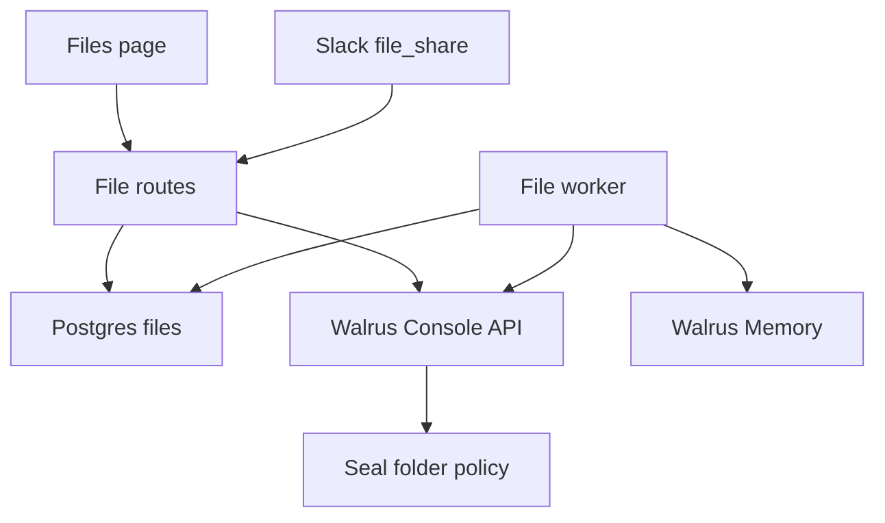

# Design: Files on Walrus Console

**Status:** active
**Owner:** @ngna3007
**Last updated:** 2026-11-09
**Scope:** Feature-level. How a file sent in a Sederunt channel is stored, shown, deleted, and forgotten.

Requirements: [Sederunt](../requirements/sederunt.md).

Upstream: [system.md](./system.md), [rooms.md](./rooms.md), [access.md](./access.md), ADR [0003 room membership](../decisions/0003-room-membership.md), ADR [0005 Walrus is the record](../decisions/0005-walrus-is-the-record.md).

## Mission

One Sederunt-owned Walrus Console account stores every channel file. By default every workspace shares one private folder. A workspace can be mapped to its own folder and its own child key. Each file is tagged with its workspace and Slack channel. Postgres decides who may see the file. The user receives decrypted bytes only after that check.

## Design principles

- **Postgres is the visibility record.** Current channel membership and the file policies decide access. A Console id on the row does not authorize a download.
- **One shared folder, and an optional folder per workspace.** The free plan allows five folders in a space. Production points at a folder that already exists. A new shared folder is created only when no folder id is configured. Isolated folders are minted out of band.
- **The service key signs and holds no SUI.** Console sponsors the folder transaction. The working key signs that transaction and the Seal session that decrypts a file. The management key stays off the runtime.
- **Ciphertext is what Console stores.** A cached copy, a signed download URL, or a redirect target is still ciphertext. Plaintext is produced on this server, for a viewer who can see the row.

## Architecture

`src/files/` uploads, lists, downloads, and deletes. `src/console/upload.js` speaks the Console HTTP API and Seal. The files adapter is `createConsoleFiles`. `resolveFolder({ tenantId, channelId })` is the tenancy seam. A row in `console_tenant_folders` selects that workspace's folder and child key. Every other workspace gets the shared folder.

The Files page groups rows by channel and shows the owner, the size, and the date. The menu is Download, Delete for the owner or an admin, and Ask owner to delete for anyone else. A pending row says Deleting…. The owner sees incoming requests. An admin sees unanswered requests older than 72 hours. The page says the bytes are stored on Walrus Console.

## Folder strategy

Console calls a folder a bucket. The scope is `private`.

When `CONSOLE_FOLDER_ID` is set, that id is the shared folder. The adapter reads its Seal policy and does not reserve, sign, or finalize a folder, and it does not insert `console_folders`. This is how production is configured: the account already has a folder, and the free plan caps a space at five folders.

When `CONSOLE_FOLDER_ID` is unset, the first use of a space reserves a private folder named `CONSOLE_FILES_FOLDER_NAME` (default `sederunt-files`):

1. `POST /api/v1/spaces/{spaceId}/buckets` with `{ name, scope: "private" }` returns sponsored transaction bytes.
2. The service key signs those bytes. The signature is posted to `POST /api/v1/buckets/{id}/finalize`.
3. The folder id and `seal_policy_id` are stored in `console_folders`, keyed by space id and name.

A 409 on reserve means the name is taken. The adapter lists folders and reuses the one with that name and a Seal policy. A name that cannot be read is an error. A 422 `plan_limit_exceeded` stops the create.

`CONSOLE_SPACE_ID` selects the space. When it is unset, the adapter lists `GET /api/v1/spaces` and uses the key's personal space.

There is no Console API to create a team space or to add members. Sharing a folder with another Console account is a manual step in the Console UI. The default is that every tenant's files share this account and this folder, separated by Postgres visibility plus the tenant and channel tags. A workspace that needs its own folder uses isolated mode.

Every file row stores `console_space_id`, `console_folder_id`, and `console_file_id`. A download, a finish, or a delete uses the folder id on that row and the credential stored for that folder.

## Tenancy

Two modes. The runtime never holds the management key and never mints keys or creates folders for isolated mode.

**Shared folder (default).** Every workspace uses `CONSOLE_FOLDER_ID`. Metadata and tags carry the workspace, the channel, and the owner. Postgres row level security and current channel membership decide who can see the row. The number of workspaces is independent of the folder cap. This is the mode that is configured today.

**Isolated mode (optional, per workspace).** `console_tenant_folders` maps `tenant_id` to `console_space_id`, `console_folder_id`, an optional `seal_policy_id`, and a `credential_id`. The child `hbr_` key and the child service private key are stored in `console_folder_credentials` as AES-256-GCM ciphertext, sealed with `MCP_SECRETS_KEY_V1` the same way `mcp_connector_secrets` is sealed. Upload, download, and delete for that workspace use that folder, that bearer, and a Seal session signed by that child service key. A mapping whose credential is missing or cannot be opened fails the request. The shared folder and the shared key are not used for that workspace.

A file that is already stored keeps the `console_folder_id` on its row. Later calls for that file use the credential for that folder, so moving a workspace to isolated mode leaves the earlier files on the shared folder.

The free plan allows 5 folders and 5 GB in a space, and 100 MiB on one upload. The shared folder uses one of the five, so a free space has room for 4 isolated workspaces beside it. The 5 GB is the space total, shared by every folder in it. More isolated workspaces need a paid plan or another space.

A key administrator, on a provisioning machine, mints the child key and grants it only that folder's Seal group. The sequence is [console-mint-plan.md](./console-mint-plan.md). The management key (`key_admin`, prefix `hbradm_`) can do three things over the API:

- Mint a child key: `POST /api/v1/api-keys`.
- Poll that key: `GET /api/v1/api-keys/{id}`.
- Sponsor and execute `grant_bucket_access`: `POST /api/v1/seal/sponsor` and `POST /api/v1/seal/sponsor/{digest}/execute`.

A data call with the management key returns 403. Listing keys and revoking a key over the API return 403 `session_required`. Revoke is a step in the Console web app. A retried mint creates a second key and leaves the first one in place.

The runtime and Vercel load the shared working key (`CONSOLE_API_KEY`, an `hbr_` key) and its service key. An isolated workspace's child key is opened from `console_folder_credentials` when that workspace is used. The management key stays on the provisioning machine. An end-user Sui address is not granted access to the shared folder. That grant would bypass channel membership. The child key is granted only its own folder's Seal group, so it cannot open the shared folder.

## Upload

The route checks current channel visibility. Configured deployments use `createSupabaseFileStore` with `SUPABASE_URL` and the server-only `SUPABASE_SERVICE_ROLE_KEY`. One transaction checks membership again, inserts the message and `uploading` file, validates the content SHA-256, stages the bytes, and queues an `upload` job. HTTP 202 means this transaction committed, not that Console finished storing the file. A fresh process can resume from the staging table. The service and Console adapter methods are asynchronous.

`file_upload_staging` temporarily contains plaintext bytes with a 100 MiB per-file limit. Only the service role can access it. The deployment must protect database storage and backups; Console encryption does not encrypt this temporary database copy. Activation and deletion remove staged bytes. Exhausted uploads remain failed until the owner discards them, which queues remote cleanup even when an earlier attempt already received a Console id.

The worker claims jobs in a database transaction with `FOR UPDATE SKIP LOCKED`, a random token, and a five-minute lease. It renews a running lease every minute. Completion, retries, and file transitions require the current token and a live lease. An expired claim can be recovered by another process; the stale worker cannot commit metadata or settle its successor's job. Twelve failed attempts exhaust a job. Delete-blob claims wait for a live upload claim to finish so an accepted remote receipt can be retained for cleanup.

The existing Node process drains jobs. Intervals and request kicks are best-effort wakeups, so hosted deployments also need a protected host-invoked drain. Durable state survives a stopped process; a durable queue does not itself guarantee that the host will invoke the worker.

 The bytes are Seal-encrypted for the folder policy and posted as multipart to `POST /api/v1/buckets/{folderId}/files`. Console answers 202. The file id is saved on the row before polling, so a retry with a saved receipt finishes that file. A crash between Console acceptance and persisting that receipt has an unknown remote outcome; no exactly-once remote upload guarantee is claimed. Job fencing protects database state, while Console's API remains a separate side effect.

A message deletion hides active, uploading and failed files atomically and queues cleanup. A delayed upload may retain its Console receipt on the pending-delete row, but cannot activate it. The deletion worker removes that receipt's bytes.

The multipart body carries the display name prefixed with the Sederunt file id (Console file names are unique inside a folder, and the field is at most 255 characters). It also carries metadata. It does not send a separate content size. Metadata is a JSON object, at most 8 KiB:

- `sederunt_file_id`
- `tenant_id`
- `channel_id`
- `owner_person_id` (the user id, or the guest id)
- `slack_file_id`

After the 202, `PATCH /api/v1/files/{id}` sets tags. A tag is at most 30 characters, and a file has at most 10. The two tags are `tenant:` plus the first 23 hexadecimal characters of the tenant id, and `channel:` plus the first 22 of the channel id, with hyphens removed. The same id always produces the same tag.

The upload is finished when `GET .../files/{id}/status` returns `completed`. On that endpoint, `queued` and `active` mean the job is still running. A 404 means the job record is gone: the adapter reads the file metadata and treats status or state `active` or `completed` as stored. `failed` fails the upload. Rows still `uploading` after one hour are marked `failed`.

Just after a folder is finalized, an upload can return 403 `mirror_missing_grant`. The post retries that code a bounded number of times.

## Download

The route loads the row through the same visibility rules as the list. It then `GET`s `.../files/{id}/download` with `redirect: manual`. Console answers 307 or 302. The server follows `Location` with a request that carries no `Authorization` header. The body is Seal ciphertext. The service key for that folder opens a session for the folder policy, the bytes are decrypted, and the plaintext is streamed to the viewer.

`POST .../download-url` mints a 15-minute link to that ciphertext. The product does not call it for a user and does not put the link in an API response. A 423 means the file is deleting or already deleted.

## Delete

The owner, or an admin of the workspace, hides the row immediately (`pending_delete`) and queues `delete_blob` and `delete_memory`. The reason is `owner`, `moderation`, or `request_approved` when the owner is approving a request. Deleting the source message does the same with reason `message_deleted`.

`delete_blob` calls `DELETE .../files/{id}`. Console answers 204 and finishes the delete in the background. The worker then reads the file metadata. `deleted`, or a 404 on the delete or on the metadata, counts as success and the row becomes `deleted`. Any other state, including `deleting`, leaves the job failed so the worker tries again. Backoff starts at one minute, doubles, and stops at six hours. The job dies after 12 attempts.

A signed URL or any other cache of the object is still ciphertext. Console does not promise that every copy disappears at the same moment as the metadata.

`delete_memory` forgets the namespace `sederunt-file-<id>`. That step runs only when `SEDERUNT_MEMWAL_KEY`, `SEDERUNT_MEMWAL_ACCOUNT_ID`, and `SEDERUNT_MEMWAL_OWNER_KEY` are set. Otherwise the worker records a skipped link and does not claim the memories were forgotten. Decisions still use the public Walrus Memory relayer. This file path does not change that.

`renew` remains a job kind. The worker skips it. Console renews storage on its own.

## Who can see a file

RLS follows current channel membership. An active file is visible to someone who can see the channel now. Someone who leaves loses the file. Someone who joins later can see older files. The owner also sees their own row while a delete is pending, so the page can say Deleting…. Other members do not.

Authenticated readers can see the Console ids on a row they can already see. Those ids do not download the file. The API key stays on the server. `console_folders`, `console_folder_credentials`, and `console_tenant_folders` have row level security on, a restrictive policy that matches nothing, and no grants for `anon` or `authenticated`. The credential table holds ciphertext, a nonce, and a key version. It does not hold a plaintext key.

A member who is not the owner may ask for a delete. One open request per file and person, and at most ten open requests a day. The owner approves or declines. An admin sees open requests older than 72 hours and may dismiss one without deleting the file. A guest who later joins the workspace takes ownership of the files they sent.

## Limits and rate limits

The free plan allows 5 GB and 5 folders in a space, and 100 MiB on one upload. Metadata is 8 KiB. Tags on a file patch are at most 10, each at most 30 characters. The adapter rejects an oversized file, oversized metadata, or a bad tag before it stores the row as active.

Console answers 429 with `Retry-After` (seconds or an HTTP date). The client waits that long, caps one wait at 60 seconds, and retries at most three times. Seal `fetch_key` is 60 requests a minute for the account. A burst of downloads shares that budget.

## Environment

Values stay in the server environment. The names are:

| Name | Required | Meaning |
|---|---|---|
| `CONSOLE_API_KEY` | for live storage | Bearer key with read-write scope (`hbr_…`) |
| `CONSOLE_SERVICE_PRIVATE_KEY` | for live storage | `suiprivkey1…` key that signs folder finalize and Seal sessions. It needs no SUI balance |
| `CONSOLE_SPACE_ID` | no | Space to use. Unset means the key's own personal space |
| `CONSOLE_FOLDER_ID` | no | Existing folder. When set, no folder is created |
| `CONSOLE_FILES_FOLDER_NAME` | no | Folder name when `CONSOLE_FOLDER_ID` is unset. Default `sederunt-files` |
| `MCP_SECRETS_KEY_V1` | to open an isolated child key | 32-byte AES-256-GCM key, 64 hex characters or base64. Same key that seals connector secrets. Server only |
| `SEDERUNT_MEMWAL_KEY` | for memory cleanup | Delegate key for the file-memory account |
| `SEDERUNT_MEMWAL_ACCOUNT_ID` | for memory cleanup | That account id |
| `SEDERUNT_MEMWAL_OWNER_KEY` | for memory cleanup | Owner key used by Security Delete |
| `SEDERUNT_MEMWAL_SERVER` | no | Relayer base URL when it differs from the public relayer |
| `FILES_DEMO` | no | `1` serves the in-memory Files page and does not call Console |

`FILES_DEMO=1` wins over a configured key inside the file runtime, so the demo page never writes to the account.

These names are used only on a provisioning machine. The runtime does not read them:

| Name | Meaning |
|---|---|
| `CONSOLE_ADMIN_KEY` | Management bearer (`hbradm_`, `key_admin`). Mints child keys and sponsors `grant_bucket_access` |
| `CONSOLE_ADMIN_SERVICE_PRIVATE_KEY` | Service key that signs the grant transaction |
| `CONSOLE_WEB_ACCOUNT_ADDRESS` | Expected `owner_address` on a new folder |
| `CONSOLE_KEY_ADMIN_ADDRESS` | Expected `admin_signer_address` on a new folder |

`scripts/console-live-proof.mjs` reads the runtime names from the environment, uploads a small text file, checks the decrypted SHA-256, reads the file metadata and tags, deletes it, reads the metadata once more, and writes a JSON proof to the path in argv. The proof has ids, states, the hash, timings, the metadata keys that came back, the values of `sederunt_file_id`, `tenant_id`, `channel_id`, `owner_person_id`, and `slack_file_id`, the tags, and the metadata status after delete (or `404`). It has no key. When `CONSOLE_FOLDER_ID` is set the script does not create a folder. Earlier testnet proof artifacts are kept in the ignored local archive.

## Schema

`supabase/migrations/20261104210000_files.sql` creates `files`, `file_delete_requests`, `file_memory_links`, and `file_jobs`. `supabase/migrations/20261104230000_files_console.sql` replaces the Walrus blob columns with `console_space_id`, `console_folder_id`, `console_file_id`, and `console_state`, and adds `console_folders`, `console_folder_credentials`, and `console_tenant_folders`. An active row needs the three Console ids. `supabase/tests/rls_tests.sql` covers visibility, delete requests, the 72 hour list, guest merge, message delete, the new ids, and the closed folder, credential, and tenant-mapping tables.

## Failure behaviour

| Case | Result |
|---|---|
| Viewer cannot see the channel | 404. The same answer as a missing file |
| Console is not configured | Upload and download say storage is paused |
| Isolated mapping has no readable credential | The request fails. The shared folder is not used |
| Plan cap, or metadata Console rejects | 422, storage is paused |
| File over 100 MiB | 413 |
| Upload accepted, then the worker dies | The saved file id is finished. A second blob is not posted |
| Upload still `uploading` after one hour | The row is `failed` |
| Delete metadata still `deleting` | The job retries until it dies at 12 |
| Delete or metadata returns 404 | The delete counts as done |
| Memory account unset | The memory job is skipped and the namespace is recorded |

## Shared visibility and imports

Every production list reads a fresh database snapshot of current memberships, channels, file rows and delete requests. Download and signed-link redemption check active file state and current channel membership again. A cached Console listing is never an authorization source. Database removal or pending deletion immediately disappears from another instance's subsequent list.

Console reconciliation in the memory/demo adapter repeats after one minute and surfaces failures. The durable adapter does not scan the shared Console folder on member requests. A controlled import is insert-only and requires a known owner, an existing matching channel/tenant, a size and a validated SHA-256. It cannot overwrite pending-delete or deleted rows. Existing Console metadata that lacks a checksum requires an explicit bounded backfill; it is not silently promoted to trusted database records. Removing a Console object outside Sederunt makes a download fail; it does not authorize deletion of database metadata or memory without a recorded intent.

Slack ingestion requires an active binding identified by workspace and channel, plus a verified linked workspace member. Unknown identities are skipped in durable mode. Message-deletion calls carry both workspace and channel, preventing a Slack timestamp collision from deleting another workspace's file. Guest ingestion in the memory demo is not a durable identity fallback.

## Disposable integration check

Run `FILES_TEST_INTEGRATION=1 node --test test/files-database.test.js` with Docker available. It creates its own PostgreSQL 16 and PostgREST 12 containers and isolated network, applies all migrations, performs real HTTP/SQL checks across independent runtimes, and removes its resources in `finally`. It does not connect to configured Supabase or reuse another project's database. Missing Docker or images fails this explicitly enabled check. The normal Files unit command is `node --test test/files*.test.js`; its database test is skipped unless enabled.
