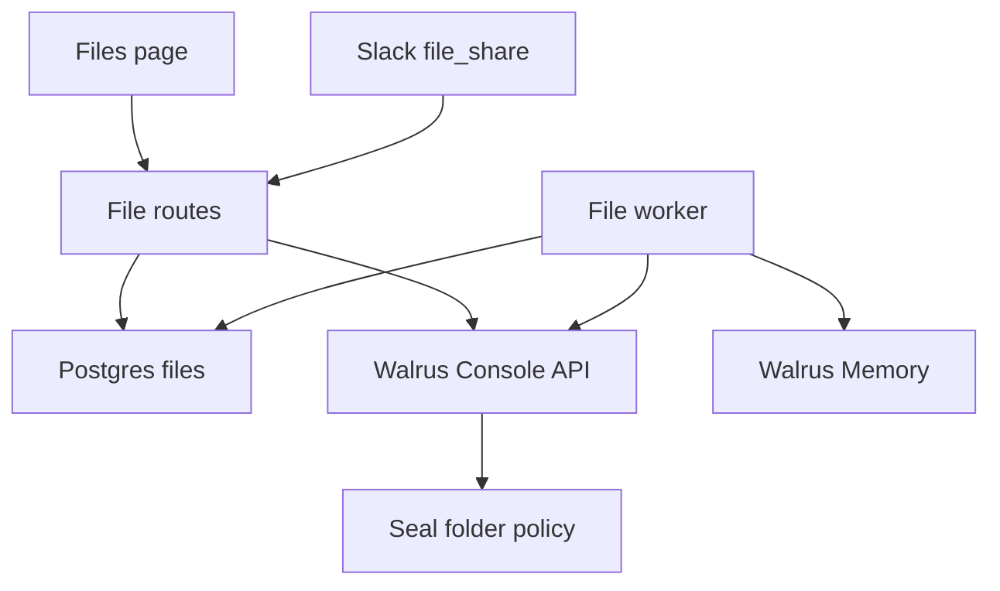

# Design: Files on Walrus Console

**Status:** active
**Owner:** @ngna3007
**Last updated:** 2026-11-04
**Scope:** Feature-level. How a file sent in a Sederunt channel is stored, shown, deleted, and forgotten.

Upstream: [system.md](./system.md), [rooms.md](./rooms.md), [access.md](./access.md), ADR [0003 room membership](../decisions/0003-room-membership.md), ADR [0005 Walrus is the record](../decisions/0005-walrus-is-the-record.md).

## Mission

One Sederunt-owned Walrus Console account stores every channel file. Each file is tagged with its workspace and Slack channel. Postgres decides who may see the file. The user receives decrypted bytes only after that check.

## Design principles

- **Postgres is the visibility record.** Current channel membership and the file policies decide access. A Console id on the row does not authorize a download.
- **One private folder per environment.** The free plan allows five folders in a space. Production points at a folder that already exists. A new folder is created only when no folder id is configured.
- **The service key signs and holds no SUI.** Console sponsors the folder transaction. The key signs that transaction and the Seal session that decrypts a file.
- **Ciphertext is what Console stores.** A cached copy, a signed download URL, or a redirect target is still ciphertext. Plaintext is produced on this server, for a viewer who can see the row.

## Architecture

`src/files/` uploads, lists, downloads, and deletes. `src/console/upload.js` speaks the Console HTTP API and Seal. The files adapter is `createConsoleFiles`. `resolveFolder({ tenantId, channelId })` is the seam a later workspace uses to point at its own space or folder. The default resolver ignores the two ids and returns the shared folder.

The Files page groups rows by channel and shows the owner, the size, and the date. The menu is Download, Delete for the owner or an admin, and Ask owner to delete for anyone else. A pending row says Deleting…. The owner sees incoming requests. An admin sees unanswered requests older than 72 hours. The page says the bytes are stored on Walrus Console. Screenshots: `docs/pr-screens/files-*.png`.

## Folder strategy

Console calls a folder a bucket. The scope is `private`.

When `CONSOLE_FOLDER_ID` is set, that id is the shared folder. The adapter reads its Seal policy and does not reserve, sign, or finalize a folder, and it does not insert `console_folders`. This is how production is configured: the account already has a folder, and the free plan caps a space at five folders.

When `CONSOLE_FOLDER_ID` is unset, the first use of a space reserves a private folder named `CONSOLE_FILES_FOLDER_NAME` (default `sederunt-files`):

1. `POST /api/v1/spaces/{spaceId}/buckets` with `{ name, scope: "private" }` returns sponsored transaction bytes.
2. The service key signs those bytes. The signature is posted to `POST /api/v1/buckets/{id}/finalize`.
3. The folder id and `seal_policy_id` are stored in `console_folders`, keyed by space id and name.

A 409 on reserve means the name is taken. The adapter lists folders and reuses the one with that name and a Seal policy. A name that cannot be read is an error. A 422 `plan_limit_exceeded` stops the create.

`CONSOLE_SPACE_ID` selects the space. When it is unset, the adapter lists `GET /api/v1/spaces` and uses the key's personal space.

There is no Console API to create a team space or to add members. Sharing a folder with another Console account is a manual step in the Console UI. Until a workspace has its own space, every tenant's files share this account and are separated by Postgres visibility plus the tenant and channel tags.

Every file row stores `console_space_id`, `console_folder_id`, and `console_file_id`.

## Upload

The route checks channel visibility, then writes an `uploading` row and queues an `upload` job. The bytes are Seal-encrypted for the folder policy and posted as multipart to `POST /api/v1/buckets/{folderId}/files`. Console answers 202. The file id is saved on the row before polling, so a retry finishes that file and does not post a second copy.

The multipart body carries the display name prefixed with the Sederunt file id (Console file names are unique inside a folder, and the field is at most 255 characters). It also carries metadata. It does not send a separate content size. Metadata is a JSON object, at most 8 KiB:

- `sederunt_file_id`
- `tenant_id`
- `channel_id`
- `owner_person_id` (the user id, or the guest id)
- `slack_file_id`

After the 202, `PATCH /api/v1/files/{id}` sets tags. A tag is at most 30 characters, and a file has at most 10. The two tags are `tenant:` plus the first 23 hexadecimal characters of the tenant id, and `channel:` plus the first 22 of the channel id, with hyphens removed. The same id always produces the same tag.

The upload is finished when `GET .../files/{id}/status` returns `completed`. On that endpoint, `queued` and `active` mean the job is still running. A 404 means the job record is gone: the adapter reads the file metadata and treats status or state `active` or `completed` as stored. `failed` fails the upload. Rows still `uploading` after one hour are marked `failed`.

Just after a folder is finalized, an upload can return 403 `mirror_missing_grant`. The post retries that code a bounded number of times.

## Download

The route loads the row through the same visibility rules as the list. It then `GET`s `.../files/{id}/download` with `redirect: manual`. Console answers 307 or 302. The server follows `Location` with a request that carries no `Authorization` header. The body is Seal ciphertext. The service key opens a session for the folder policy, the bytes are decrypted, and the plaintext is streamed to the viewer.

`POST .../download-url` mints a 15-minute link to that ciphertext. The product does not call it for a user and does not put the link in an API response. A 423 means the file is deleting or already deleted.

## Delete

The owner, or an admin of the workspace, hides the row immediately (`pending_delete`) and queues `delete_blob` and `delete_memory`. The reason is `owner`, `moderation`, or `request_approved` when the owner is approving a request. Deleting the source message does the same with reason `message_deleted`.

`delete_blob` calls `DELETE .../files/{id}`. Console answers 204 and finishes the delete in the background. The worker then reads the file metadata. `deleted`, or a 404 on the delete or on the metadata, counts as success and the row becomes `deleted`. Any other state, including `deleting`, leaves the job failed so the worker tries again. Backoff starts at one minute, doubles, and stops at six hours. The job dies after 12 attempts.

A signed URL or any other cache of the object is still ciphertext. Console does not promise that every copy disappears at the same moment as the metadata.

`delete_memory` forgets the namespace `sederunt-file-<id>`. That step runs only when `SEDERUNT_MEMWAL_KEY`, `SEDERUNT_MEMWAL_ACCOUNT_ID`, and `SEDERUNT_MEMWAL_OWNER_KEY` are set. Otherwise the worker records a skipped link and does not claim the memories were forgotten. Decisions still use the public Walrus Memory relayer. This file path does not change that.

`renew` remains a job kind. The worker skips it. Console renews storage on its own.

## Who can see a file

RLS follows current channel membership. An active file is visible to someone who can see the channel now. Someone who leaves loses the file. Someone who joins later can see older files. The owner also sees their own row while a delete is pending, so the page can say Deleting…. Other members do not.

Authenticated readers can see the Console ids on a row they can already see. Those ids do not download the file. The API key stays on the server. `console_folders` has row level security on, a restrictive policy that matches nothing, and no grants for `anon` or `authenticated`.

A member who is not the owner may ask for a delete. One open request per file and person, and at most ten open requests a day. The owner approves or declines. An admin sees open requests older than 72 hours and may dismiss one without deleting the file. A guest who later joins the workspace takes ownership of the files they sent.

## Limits and rate limits

The free plan allows 5 GB and 5 folders in a space, and 100 MiB on one upload. Metadata is 8 KiB. Tags on a file patch are at most 10, each at most 30 characters. The adapter rejects an oversized file, oversized metadata, or a bad tag before it stores the row as active.

Console answers 429 with `Retry-After` (seconds or an HTTP date). The client waits that long, caps one wait at 60 seconds, and retries at most three times. Seal `fetch_key` is 60 requests a minute for the account. A burst of downloads shares that budget.

## Environment

Values stay in the server environment. The names are:

| Name | Required | Meaning |
|---|---|---|
| `CONSOLE_API_KEY` | for live storage | Bearer key with read-write scope (`hbr_…`) |
| `CONSOLE_SERVICE_PRIVATE_KEY` | for live storage | `suiprivkey1…` key that signs folder finalize and Seal sessions. It needs no SUI balance |
| `CONSOLE_SPACE_ID` | no | Space to use. Unset means the key's own personal space |
| `CONSOLE_FOLDER_ID` | no | Existing folder. When set, no folder is created |
| `CONSOLE_FILES_FOLDER_NAME` | no | Folder name when `CONSOLE_FOLDER_ID` is unset. Default `sederunt-files` |
| `SEDERUNT_MEMWAL_KEY` | for memory cleanup | Delegate key for the file-memory account |
| `SEDERUNT_MEMWAL_ACCOUNT_ID` | for memory cleanup | That account id |
| `SEDERUNT_MEMWAL_OWNER_KEY` | for memory cleanup | Owner key used by Security Delete |
| `SEDERUNT_MEMWAL_SERVER` | no | Relayer base URL when it differs from the public relayer |
| `FILES_DEMO` | no | `1` serves the in-memory Files page and does not call Console |

`FILES_DEMO=1` wins over a configured key inside the file runtime, so the demo page never writes to the account.

`scripts/console-live-proof.mjs` reads these names from the environment, uploads a small text file, checks the decrypted SHA-256, deletes it, and writes a JSON proof to the path in argv. The proof has ids, states, the hash, and timings. It has no key. When `CONSOLE_FOLDER_ID` is set the script does not create a folder. The earlier testnet proof is history under `docs/archive/`.

## Schema

`supabase/migrations/20261104210000_files.sql` creates `files`, `file_delete_requests`, `file_memory_links`, and `file_jobs`. `supabase/migrations/20261104230000_files_console.sql` replaces the Walrus blob columns with `console_space_id`, `console_folder_id`, `console_file_id`, and `console_state`, and adds `console_folders`. An active row needs the three Console ids. `supabase/tests/rls_tests.sql` covers visibility, delete requests, the 72 hour list, guest merge, message delete, the new ids, and the closed folder table.

## Failure behaviour

| Case | Result |
|---|---|
| Viewer cannot see the channel | 404. The same answer as a missing file |
| Console is not configured | Upload and download say storage is paused |
| Plan cap, or metadata Console rejects | 422, storage is paused |
| File over 100 MiB | 413 |
| Upload accepted, then the worker dies | The saved file id is finished. A second blob is not posted |
| Upload still `uploading` after one hour | The row is `failed` |
| Delete metadata still `deleting` | The job retries until it dies at 12 |
| Delete or metadata returns 404 | The delete counts as done |
| Memory account unset | The memory job is skipped and the namespace is recorded |
