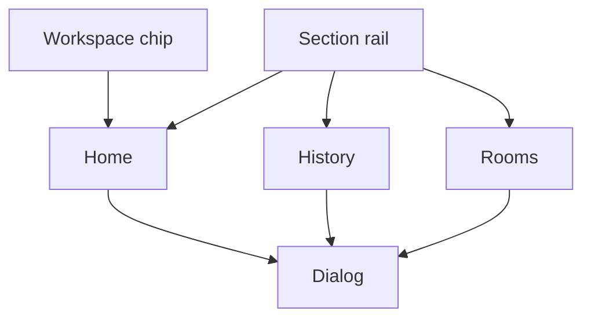

# Design: Workspace

**Status:** draft
**Owner:** @ngna3007
**Last updated:** 2026-11-03
**Scope:** Feature-level. The signed-in workspace the operator opens. This is not Walrus Console.

## Mission

Give the operator one workspace at a time, and make the next action obvious. Home answers two questions: what is waiting, and which rooms heard a decision. History is the audit of that workspace. The gate still writes. This surface does not.

## Direction

Reading this as: an operator workspace. The shell stays put and the page inside it changes. Motion is hover and focus only.

The visual system is the light console in `src/console.css`. Geist is the UI face and Geist Mono is the label face. Both come from the `geist` package (SIL Open Font License).

| Token | Value | Use |
|---|---|---|
| Background | `#f7f8fb` | Page ground |
| Card | `#ffffff` | Cards, menus, dialogs |
| Foreground | `#171a24` | Body text |
| Muted text | `#5e636f` | Secondary sentences and table heads. Passes 4.5:1 on the background |
| Border | `#dce0e6` | 1px rules |
| Input | `#d2d6de` | Field borders |
| Primary | `#2458f6` | The landing action blue: current section, primary button, focus. White on it is about 5.5:1 |
| Primary hover | `#1a46d4` | Pressed and hover fill. White on it stays above 4.5:1 |
| Primary subtle | `#eef1fb` | Selected nav, chips, and avatar ground. The landing wash |
| Primary border | `#8ebcff` | Chip and focus edge. The landing light blue |
| Primary text | `#ffffff` | Text on the accent |
| Sidebar | `#f1f3f9` | Rail, 240px |
| Success text | `#146c34` | A kept or sent state. Darker than the fill so small text passes 4.5:1 |
| Warning text | `#8a5a00` | Waiting. Darker than the fill so small text passes 4.5:1 |
| Failed | `#d42f34` | A failed state |

Radius is 6px on buttons and inputs, 10px on cards and dialogs, and full pills on chips and badges. The sidebar is 240px. The top bar is 52px. Labels are 11.5px mono, uppercase, tracking 0.07em.

Section labels stay short and uppercase. That is the label voice. It is not a poster heading.

The company tile is the brand blue. The personal tile is solid `#171a24`. The two tiles stay different so the menu can tell the workspaces apart. Cards do not float. The menu and the dialog are the only elevated surfaces. The waiting cell is the one tinted surface, because that count is the action. The top bar may blur. No glow, no radial orbs.

## Design Principles

- Home is the waiting count and the rooms. History is a different page.
- A count is a count of records in the open workspace. It does not name a week, a trend, or a customer base the record does not have.
- The workspace list lives in the top chip. The sidebar is the sections of the workspace that is open.
- A room row opens the room page. The page is two panes: the transcript on the left, and overview, decisions, waiting, and settings on the right.
- Close is the X at the top right, the shade, or Escape.
- A control that cannot do its action is not drawn.
- A private note is never shared as a room, and it never appears in the company workspace.

## Architecture

The chip switches the open workspace and returns to Home. Switching clears the open dialog. The rail switches the section inside the open workspace and clears the dialog. The dialog reads the open record. It does not call Memory, Console, Tatum, or a connector by itself.

### Shell

The top bar carries the wordmark, the workspace chip, and the operator initials. The wordmark returns to Home. The chip opens the workspace menu: each workspace, then Create a workspace. The sidebar repeats the open workspace's name and the sections. It does not repeat the workspace list.

On a narrow width the sidebar becomes one horizontal row of sections under the top bar. The row scrolls inside itself. The page does not scroll sideways. Tables scroll inside their card.

### Home

The page title is Home. The line under it says what the page is for: what is waiting, and which rooms heard it. Under that, one caption says "Sample record. This preview does not write." It is a caption, not a second panel.

Four counts share one bordered row, because they are one record split four ways, not four products:

| Count | What it counts |
|---|---|
| Decisions kept | Answer and kept records in this workspace |
| Waiting on you | Records whose state is waiting |
| Sent | Records whose state is sent. The label does not say "this week". The line under it says the tool accepted it |
| Failed | Records whose state is failed, still open |

When Waiting on you is above zero, that cell is tinted and it is a button. It opens History on You, with every kind shown, so the waiting changes are in the list. The line on the cell says "Confirm one change". The other three counts stay quiet. When the count is zero, the cell is not a button, and it says nothing is waiting.

Under the counts, the rooms use the same blocks as the Rooms page in [rooms.md](./rooms.md): the platform mark beside the title, where the room is, who was present, and the bot name. The last decision opens with the dialog. A block opens the room dialog. When the company workspace has no rooms, the list says so and offers New room. A personal workspace says private notes stay there and are never shared as rooms, and offers no such button.

### History

Group is what a room heard. You is what the operator asked. Within either, a row is a question, an action, or other. A question is a sentence that was kept. An action is a change in a connected tool. Other is everything else, including a request that shows no sentence and a change to a tool preference. All shows those groups. Each group can be shown alone. A row opens that record's dialog.

A waiting record offers Confirm and Dismiss, and the line "Confirm covers that change only." Confirm marks that one record sent. Dismiss marks that one record dismissed. Neither touches a second waiting record.

An access record shows who asked and that no sentence is shown. It does not show the decision. The company account keeps that row, so it remains after a new process.

### Other sections

Connectors shows each write tool and its preference, Ask or Do. Ask waits. Do sends the request already made. A new tool starts on Ask.

People lists display names heard in a room while the bot was there, and says a display name is not an id.

Record shows a clash as both sentences, the file name, and each proof. It does not show bytes.

Chat can repeat a question about what is already kept in the open workspace. The thread does not follow the operator into another workspace. Sending appends the question and the line "This page does not write a decision. Ask in the room." An empty send states that the question is missing. An empty thread says nothing has been asked here yet. Chat is not the front door.

### States

| State | What the operator sees |
|---|---|
| Ready | The counts and the room blocks of the open workspace |
| Empty | Why it is empty, and the one action that fills it. A personal workspace says private notes stay there and are never shared as rooms |
| Loading | "Loading this workspace." No skeleton of a layout the record will not have |
| Error | What failed, and a way to try the read again |
| Sample | The sentence "Sample record. This preview does not write." Counts then belong to that sample, and they are labeled as such |

Confirm, Dismiss, Ask, Do, the workspace chip, and New room each change the open state. A button with no action is not shown.

## Cross-Cutting Concerns

### Security

#### Assumptions

- The operator already holds the two accounts. This surface does not sign a member in.
- A sample is not a live write. The sentence on the page says so.

#### Known Gaps and Risks

| Gap | Severity | Impact | Root Cause | Mitigation |
|---|---|---|---|---|
| A sample uses the names from the requirements scenario | low | A reader may think the preview is a live customer | The scenario is the only record the preview has | The sample sentence stays visible |
| Initials stand in for the operator | low | They look like an account | No portrait was supplied | Initials only, not a photo and not an address |

#### Controls

- The surface omits account ids, keys, and tokens. A proof is a checkpoint sequence or the word unknown.
- A file is named. The bytes stay in Walrus Console. The dialog does not open them.
- Escape closes the topmost layer: the dialog, then the menu.

## Constraints

- [0001](../decisions/0001-one-process.md): the gate stays one Node process. This surface calls it. It does not become a second writer.
- [0002](../decisions/0002-two-accounts.md): company and personal are two workspaces.
- [0003](../decisions/0003-room-membership.md): members do not sign in here.
- [0004](../decisions/0004-write-preference.md): Ask and Do are per tool.
- [0005](../decisions/0005-walrus-is-the-record.md): the dialog shows the record. It is not a second store.
- The public landing is a different surface. This design does not restyle it.

## Acceptance Criteria

| Requirement | Satisfied by |
|---|---|
| SED-2.2 | Shell, the workspace chip |
| SED-2.5 | Record |
| SED-3.2 | History, an access row |
| SED-3.5 | Security, no member sign-in |
| SED-4.1, SED-4.3, SED-4.4 | Connectors, and Confirm on a waiting row |
| SED-5.3, SED-5.4 | Record, the proof line |
| SED-6.2, SED-6.4 | Record, the file name |
| SED-7.2, SED-7.3, SED-7.4 | Security |

## Open Points

- The live read's loading and error copy is specified above. The preview has no network read, so those two states are not on the sample path.
- Chat stays a side section. Whether a later version drops it is open. It must not become the front door.

## Links

- Requirements: [docs/requirements/sederunt.md](../requirements/sederunt.md)
- Decisions: [docs/decisions/](../decisions/)
- System: [docs/design/system.md](./system.md)
- Rooms: [docs/design/rooms.md](./rooms.md)
- Entities: [docs/design/entities.md](./entities.md)
- Actions: [docs/design/actions.md](./actions.md)
