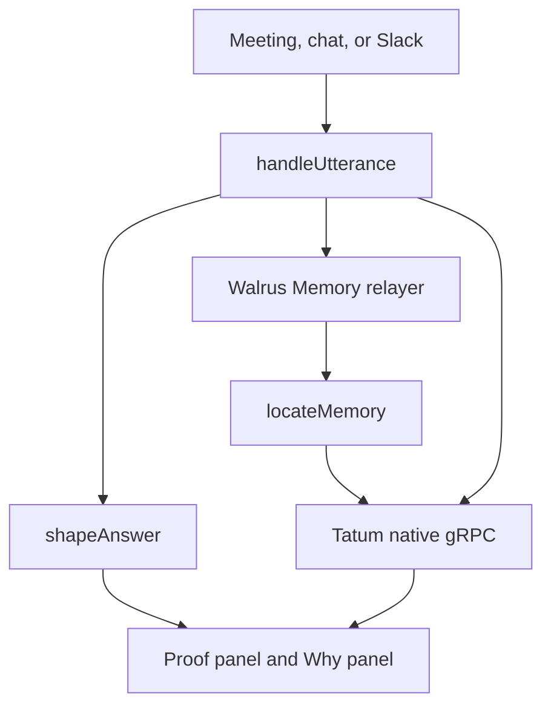

# Total Recall

Sederunt joins a meeting, keeps what was decided, and answers later from that record. The sentence lives in Walrus Memory on mainnet. The proof that the blob is real lives on Sui, and every Sui mainnet read goes through Tatum gRPC.

A later answer is not only a search hit. Before the bot speaks, it recalls memories in the `sederunt` namespace. A correction replaces the old sentence. A team preference or an action item is added when it is about the same topic. The chat shows a Why list, so the memories that changed the answer are visible, with a verified-on-chain badge when Tatum has checked the blob.

## Architecture



Writes use the existing company MemWal client against `https://relayer.memory.walrus.xyz`, namespace `sederunt`. The managed relayer pays WAL and SUI for `remember()`. Reads of Sui never use public GraphQL and never use `fullnode.mainnet.sui.io`. The gateway is `https://sui-mainnet-grpc.gateway.tatum.io:443` with header `x-api-key`. The SDK's default transport speaks grpc-web. This gateway rejects that, so `src/tatum/transport.js` frames unary calls as native `application/grpc` over `node:http2` and passes that transport to `SuiGrpcClient`.

Without `TATUM_API_KEY` the client throws `Tatum key not set` and the proof is `unknown`. It does not fall back to another RPC. The key is not written to the log. Errors have the key replaced with `[redacted]`.

## Tatum methods

| Method | Where | Why |
|---|---|---|
| `LedgerService/GetObject` | `src/tatum/client.js` `getObject`, used by `createTatumReader` and `readProofs` | The Blob object, its bytes, owner, and `previous_transaction` |
| `StateService/ListOwnedObjects` | `client.listOwnedObjects`, called from `src/memory/locate.js` | Find the Blob among the owner's objects when only the blob id is known |
| `LedgerService/GetTransaction` | `client.getTransaction` | Checkpoint and timestamp of the certifying transaction. Cached |
| `LedgerService/GetCheckpoint` | `client.getCheckpoint` | Checkpoint time when the chain tip is refreshed. Cached |
| `LedgerService/GetServiceInfo` | `client.refreshChain` | Latest checkpoint, shown as live chain context |

A stored object id makes the next read a single `GetObject`. Listing needs the owner address returned by `rememberAndWait`. There is no whole-chain blob-id index on these methods, so a blob with neither an object id nor an owner stays `unknown`.

The shared throttle defaults to 3 requests a second (`TATUM_RPS`). `429`, `RESOURCE_EXHAUSTED` (gRPC 8), and `UNAVAILABLE` retry with exponential backoff, jitter, and a bound (`TATUM_RETRIES`, default 3 extra tries). Each call has a timeout (`TATUM_TIMEOUT_MS`, default 8000). The call log is method, milliseconds, and outcome. The room shows `Read via Tatum gRPC · N calls · last ms` plus the latest checkpoint. Verify again runs the same check.

A proof is `verified` when the Blob exists, its blob id matches, it is certified, the owner matches when one was stored, and the checkpoint and time are known. A hard mismatch is `unverified`. A missing read is `unknown`. Suiscan links are `https://suiscan.xyz/mainnet/object/<id>`, `/tx/<digest>`, and `/checkpoint/<n>`. The owner address is not shown.

## Learning

`src/memory/learn.js` scores memories against the question. Corrections that share a content word replace the answer. Team preferences and action items with a shared word are appended when they are not already in the text. Decisions are listed in Why and are not pasted again.

The same path runs for a typed recall, chat, and a Slack reply. Minutes drafted at the end of a meeting include a remembered preference about where to post them.

Say `correction: The offsite is in Da Lat, not Da Nang.` or `prefer post minutes to #sederunt-demo.` The next answer changes. The write uses an idempotency key `learned:<kind>:<hash>`, so a retry does not store a second blob.

## Meeting outcomes

`rememberMeetingOutcome({ room, minutes, actionItems, decisions })` in `src/memory/outcome.js` writes three kinds:

- `minutes`, key `minutes:<roomId>`
- `action-item`, key `action-item:<roomId>:<owner>:<hash>`
- `decision`, key the decision id, skipped when that decision already has a blob id

Each payload is JSON with the room id, attendees, owner, due date, and source. `endMeeting` calls this when a Recall `bot.done` (or a done `bot.status_change`) names the bot id, which is the room id.

PR #7 (`feat/bot-behavior-followups`) renders minutes with `renderMinutes` and does not write memory. After that call, one line is enough:

```js
await rememberMeetingOutcome({ room, minutes: renderMinutes(draft), actionItems, decisions, remember });
```

## Seed script

`scripts/hackathon-seed-memories.mjs` prepares 13 demo memories: decisions, minutes, action items, team preferences, and one correction. The default is a dry run. It uses a fake relayer and a fake Tatum client, prints the plan, and writes a proof report when `--report` or `HACKATHON_PROOF_REPORT` is set. Placeholder ids are not on chain.

```bash
node scripts/hackathon-seed-memories.mjs
node scripts/hackathon-seed-memories.mjs --report /tmp/proof.json
```

A live run writes to the company MemWal account on mainnet and then verifies each blob through Tatum. It requires both flags:

```bash
HACKATHON_CONFIRM_MAINNET=yes node scripts/hackathon-seed-memories.mjs --live
```

Estimated cost of `remember()` on the managed relayer is $0 to this wallet. Creating the MemWal account and registering a delegate key is done once at https://memory.walrus.xyz and spends a small owner-wallet gas fee. The script does not create that account. The dry run also prints how many Tatum calls the verify would use at the free-plan rate.

### Mainnet seed, 2026-11-04

The 13 demo memories were written to the company `sederunt` namespace on Sui mainnet between 23:43 and 23:50 UTC+7 (checkpoint times). Every write went through the MemWal managed relayer at relayer.memory.walrus.xyz, which paid WAL and SUI. No transaction came from the owner wallet.

The first run was cut off by the shell after 4 memories. Recall showed those 4 had landed once each, so the second run used `--skip-existing`, found them by recall, and wrote the other 9. The script now writes its report after every memory, so a cut-off run still shows what landed.

After the seed the namespace holds 28 memories. A recheck at 23:54 UTC+7 verified all 28 through Tatum gRPC in 39.3 s at 3 requests per second, with one retry. The 13 new blobs were certified in Walrus epoch 43, at checkpoints 341,620,219 to 341,621,779.

- Booth decision: [object](https://suiscan.xyz/mainnet/object/0xf734ea6c946482d9bf28f6443ea6529099a67cc306717562361cd463438de944), [transaction](https://suiscan.xyz/mainnet/tx/EMyYSF9gsiefY7HcMJUyDGj7VAmhpJSPqVr6Y7ZANQrZ), [checkpoint](https://suiscan.xyz/mainnet/checkpoint/341620328)
- Offsite decision: [object](https://suiscan.xyz/mainnet/object/0x4d720f662973a9098dcf277c64a3c5b22ed995e6c295c1d5b58daea38f948107), [transaction](https://suiscan.xyz/mainnet/tx/7Sj2oR33ZX4F7WsufZ7GC1tYQbLbm2ugjwfJtcKA5Eyh)

The full list, with blob ids, objects, transactions, checkpoints, and epochs, is in [`docs/hackathon/mainnet-seed-proof.json`](hackathon/mainnet-seed-proof.json). It holds no keys or account ids.

## Environment names

The process reads these names. Values stay in the environment or in `COMPANY_ENV_FILE`. They are not printed.

| Name | Use |
|---|---|
| `TATUM_API_KEY` | Sui mainnet gRPC gateway |
| `TATUM_RPS` | Requests per second. Default 3 |
| `TATUM_RETRIES` | Extra retries after the first try. Default 3 |
| `TATUM_TIMEOUT_MS` | Per-call timeout. Default 8000 |
| `TATUM_GATEWAY` | Override the gateway URL |
| `COMPANY_MEMWAL_KEY` | Company delegate key |
| `COMPANY_MEMWAL_ACCOUNT_ID` | Company MemWal account |
| `COMPANY_MEMWAL_SERVER` | Relayer URL. Default `https://relayer.memory.walrus.xyz` |
| `COMPANY_ENV_FILE` | Optional file of `MEMWAL_PRIVATE_KEY`, `MEMWAL_ACCOUNT_ID`, `MEMWAL_SERVER_URL`, `TATUM_API_KEY` |
| `HACKATHON_CONFIRM_MAINNET` | Must be `yes` together with `--live` |
| `HACKATHON_PROOF_REPORT` | Where the seed script writes the proof JSON |

`npm test` uses fakes. It does not call Tatum or the relayer.
