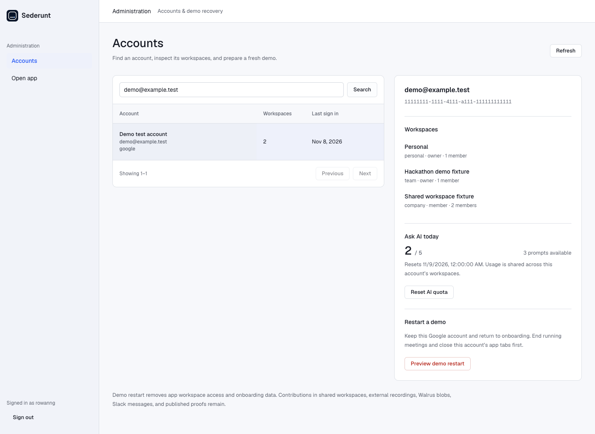
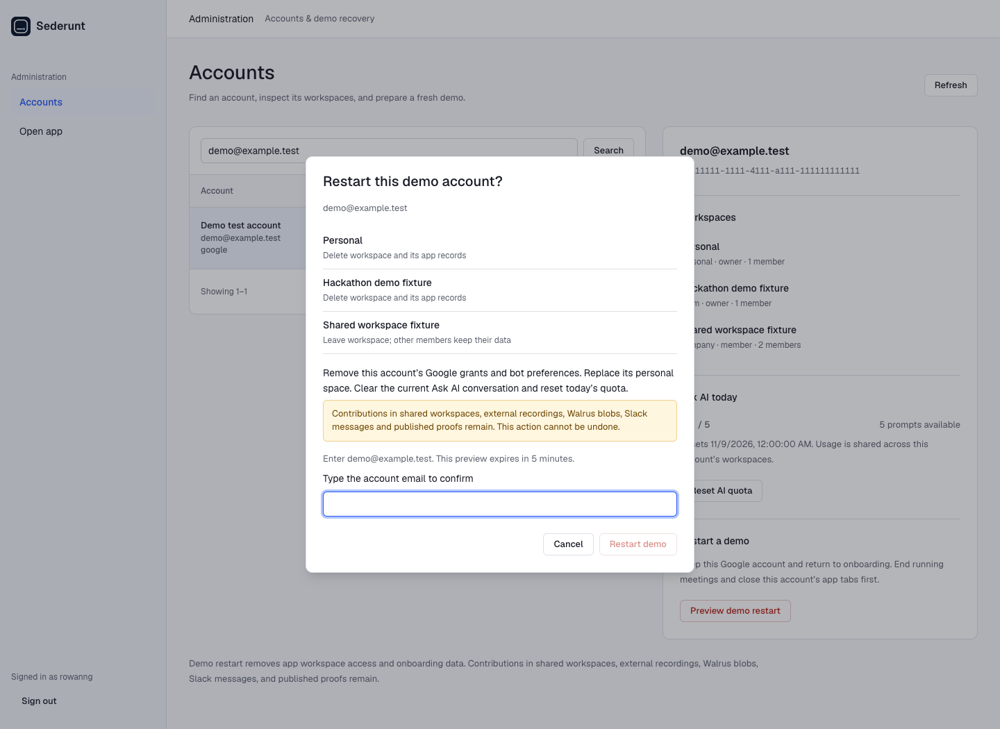

# Recover a demo account

Use this before a new recording when an existing Google account needs a fresh onboarding attempt. **Ask AI stays before the Slack demonstration** in the [new-user live-demo procedure](./new-user-live-demo.md).

The admin page is live at [sederunt.vercel.app/admin](https://sederunt.vercel.app/admin). Its database migration and production admin environment variables are installed. Local screenshots below use clearly labelled test fixtures, not production accounts.

## Pick the right action

| What went wrong | Action | Result |
| --- | --- | --- |
| The daily question allowance ran out | **Reset AI quota** | Restore today's allowance for this account. Keep questions, files, settings and workspaces. |
| Onboarding or workspace setup needs a new take | **Delete user data** | Keep the Google login, replace the personal space, delete workspaces where this account is the only member and owner, and leave other shared workspaces. Clear its app Google grants, bot preferences, tool choices and current AI conversation. |
| The account is the only owner of a workspace containing other members | Restart is blocked | Transfer ownership through an approved workspace administration procedure first. There is no ownership-transfer button on this admin page. Other members' data must remain available. |

AI usage belongs to the account across all its workspaces. It is not a separate allowance per workspace.

## Before opening admin

1. End any running meeting and stop speaking to the bot. Let any AI answer finish. Do not start a new question during recovery.
2. Close this account's ordinary Sederunt app tabs. Keep the admin tab in a separate browser profile if possible.
3. Stop screen recording. Keep admin credentials, private account emails and confirmation details out of the public demo.
4. Confirm this is your disposable demo account. Do not use a protected or shared production account to manufacture a fresh-user recording.

## Sign in and locate the account

1. Open the deployment's `/admin`, for example `https://sederunt.vercel.app/admin` **after deployment**. A signed-out browser redirects to `/admin/login`.
2. In the centered **Admin sign in** card, enter `rowanng` in **Username** and the password supplied privately in **Password**. Click the blue **Sign in to admin** button beneath the fields. Expected: **Accounts** opens. An incorrect password produces an inline error; correct both fields and try again. Ten attempts in a ten-minute server window trigger a temporary lockout.
3. At the top of the account table, on the left of the desktop screen, click **Search email or name**. Enter the demo Google email and click **Search** to its right. Expected: the matching account row. An empty list says **No accounts match this search**; check the email and search again.
4. Click the account's name/email in the first column. Expected: its detail panel opens on the right. On a phone, scroll below the account table to the same panel.
5. Read the email and account ID at the top of that panel. Under **Workspaces**, check every workspace name, role and member count. Under **Ask AI today**, check prompts used and the reset time. Stop if this is the wrong account.

The sidebar's **Accounts** returns to the directory. **Open app** opens `/console`. **Refresh** at the top right reloads the directory and selected account. **Previous** and **Next** below the table move through 25 accounts per page.

The [phone screenshot](../pr-screens/admin-accounts-mobile.png) shows the same controls stacked vertically.

## Reset only AI quota

1. In the selected account's **Ask AI today** section, click **Reset AI quota**.
2. In **Reset today's AI quota?**, check the account email and read the scope. It preserves the conversation and workspace data.
3. Under **Type the account email to confirm**, enter the exact displayed email. The **Reset quota** button at the bottom right enables only when it matches. For accounts without email, the field asks for the account ID instead.
4. Click **Reset quota** once. Expected: the dialog closes, the page confirms the reset, and the usage counter returns to zero. If you change your mind, **Cancel** or Escape closes the dialog without applying it.
5. Return to the ordinary Sederunt browser profile, open **Ask AI** in the sidebar, and reload the page. Expected: previous turns remain and the full daily allowance is available. Continue the recording from a planned starting point; this operation does not make onboarding new.

If the page reports that an AI answer is still running, let it finish, then preview again. If the quota reset succeeded but the audit write failed, the message says so; do not keep clicking reset to diagnose the database.

## Restart onboarding with the same Google login

1. In the account detail panel, scroll to **Delete user data** and click the red **Delete user data** button.
2. Read **Delete this user’s data?**. Each affected workspace has a separate row:
   - **Delete workspace and its app records** applies only when this account is its sole member and owner. This includes replacing the old personal space.
   - **Leave workspace; other members keep their data** removes this account's membership. Contributions already in that shared workspace remain with it.
3. Read the retention notice. This is a fresh app attempt, not erasure of recordings, Walrus blobs, Slack messages or published proofs. Existing Google consent at Google can also remain.
4. Enter the exact displayed account email in the confirmation field. Click **Delete user data** at the bottom right once. Expected: **Applying…**, then a success notice and refreshed account details showing a new personal space and no shared workspace memberships.
5. If the preview expires after five minutes, or membership changed, cancel and click **Delete user data** again. Review the new scope. A consumed confirmation cannot be replayed.
6. If a connection/AI cleanup warning appears, do not begin recording. Restore Redis, then preview and confirm the restart again. The server retains retired workspace IDs so the retry can release old meeting and Slack bindings as well as retry AI cleanup. The deleted workspace stays inaccessible during recovery.
7. In the ordinary Sederunt browser profile, open `/console/sign-in`. If still signed in, use Sederunt's account menu to **Sign out** first. Click **Continue with Google** and choose the **same Google account**. Expected: **Create your workspace**, step 1 of 4. Google's chooser may skip consent already granted; do not describe this as a first-ever Google authorization.
8. Start the [new-user live-demo runbook](./new-user-live-demo.md) again with a new workspace. Reconnect Calendar and Slack when prompted. The story sequence remains **meeting → Ask AI → Slack → Files**.
9. Back in admin, click **Sign out** at the bottom of the left sidebar when finished.

There is no undo for a confirmed restart. Cancel before confirming if the scope is wrong. To recover afterward, sign in again and create a new workspace; retained external archives are not an automatic workspace restore.

## Deployment and verification

1. Review `supabase/migrations/20261108100000_admin_demo_reset.sql`. Apply that migration to the intended Supabase project before deploying the routes. It adds service-role-only RPCs, durable preview nonces, login throttling and an audit log. It does not reset an account when applied.
2. In Vercel's Sederunt project, open **Settings → Environment Variables**. Configure `SEDERUNT_ADMIN_USERNAME`, `SEDERUNT_ADMIN_PASSWORD_HASH` and `SEDERUNT_ADMIN_SESSION_SECRET` for the intended environment. Use the private values already prepared in the gitignored `.local/admin.env`; never copy a plaintext password into source. The session secret must be at least 32 characters. Keep `SUPABASE_URL` and the existing `SUPABASE_SECRET_KEY` or service-role key server-side. Keep the production Redis connection.
3. Deploy from a reviewed branch containing both the admin changes and the existing production Slack OAuth work. Production is ahead of `main` in that feature; deploying plain `main` would remove the per-tenant install path. Do not replay historical migrations merely because their applied timestamp differs from this checkout.
4. Open `/admin`, sign in, search an account, and inspect workspaces and AI usage. A read-only smoke check is sufficient against real accounts. Exercise destructive confirmation only with an expressly disposable test account.
5. Verify the ordinary `/console` Google sign-in and **Add to Slack** path still work. Preserve the deployment SHA in the private demo notes.

To disable new admin logins, remove an admin auth environment variable and redeploy. Preserve the migration, service-role configuration and workspace-existence checks so callbacks cannot resurrect removed workspaces. Removing credentials is not a data restore.

## Retention details

- Supabase cascades delete app records belonging to deleted workspaces. Shared workspace data stays with its remaining members.
- The account's Google identity and display profile remain. App grants and Sederunt onboarding/tool preferences are cleared; Google's own consent is outside this reset.
- Redis removes indexed questions and chunks, including answers beyond the visible 20-turn list created after this implementation. Older, pre-index answers that already fell outside that list expire on their existing TTL, normally seven days. Do not claim immediate physical erasure of those legacy streams.
- Old file bytes, recordings, Slack messages, immutable proofs and semantic memory blobs can remain in external services. Removed tenant IDs and membership checks keep them out of a newly created workspace. This page offers no external erasure guarantee.
- Reset is coordinated across Supabase and Redis, not a distributed transaction. Stop concurrent app work first. Partial cleanup is reported and can be retried using a new preview.

## Layout source and review evidence

The [shadcn/ui dashboard example](https://github.com/shadcn-ui/ui/blob/main/apps/v4/registry/new-york-v4/blocks/dashboard-01/page.tsx) informed the navigation/header/table hierarchy. The implementation uses Sederunt's existing Node renderer and [design system](../design/design-system.md), without importing a dashboard framework. The account actions sit beside the table because identifying the correct person is the decision that precedes a reset. No metric cards or unrelated charts are included.

Design read: operations screen for demo recovery, following Sederunt's existing console identity. **ENERGY 1 / RHYTHM 1 / MOTION 1**. Geist, the blue selection accent and real logo come from the existing product. White-space separates identity, membership, usage and recovery; red is reserved for destructive actions. Native dialogs use the same surface, radius, scrim and elevation tokens as console dialogs.

Local browser review covered sign-in validation, wrong password, successful sign-in, search results and empty results, pagination, selection, quota preview, mismatch-disabled confirmation, Cancel, Escape, quota execution, restart scope, restart execution, Refresh after error, brand navigation, Accounts navigation and sign-out. No JavaScript page errors were observed. Desktop 1440px, phone 390px and tablet 768px were checked; the mobile layout stacks the account detail beneath the table without horizontal overflow.

Validation on 8 November 2026: 88 focused admin/design/Ask AI/Files/tenant tests passed, including a clean migration of all local SQL into disposable PostgreSQL and reset tests against real local Redis. The full-suite comparison had 34 failures in both the changed tree and unchanged `main`, with identical failing test names. These existing console/backend failures remain unresolved. No production account was reset, no production migration was applied, and no deployment was made during this verification.

### Prepared release and compatibility checks

The isolated release branch is `feat/admin-demo-recovery`, based on production's Slack OAuth commit `54cab8e56a3bfdc0dc2a482089565afb075787db`. This preserves the deployed Slack onboarding and calendar fixes while adding admin recovery. The release worktree is `.local/tmp/admin-release`; its dependency symlink is local setup and must not be committed.

An additional release validation on 8 November 2026 passed **110 selected tests, zero failures and zero skips**, covering admin authentication/actions, the real PostgreSQL migration and Redis cleanup, Slack multitenancy, onboarding, tenant authorization, design tokens, Ask AI streaming and Files sessions. The database fixture explicitly proves that a restart removes a sole-member workspace's Slack installation and connection state, preserves the shared workspace's connection, and permits the same Slack team to install into the newly created workspace. These are local database checks; they do not prove a live Slack consent exchange.

Production rollout was approved and completed on 8 November 2026. The new migration, production admin credentials and release deployment are installed. Live browser checks passed for login, account/workspace details, AI quota display, responsive layout, sign-out and ordinary Google sign-in. No account reset or quota reset was executed. See the [production rollout evidence](../reports/2026-11-08-admin-production-rollout.md). Use an expressly disposable account for any destructive recovery rehearsal.

### UI delivery gate

This gate covers the new admin surface. The ordinary console has existing failures on unchanged `main`; they are recorded separately from the admin checks.

| Gate | Result and evidence |
| --- | --- |
| R-02, copy punctuation | PASS: admin UI copy contains no em dashes. |
| R-03, mobile | PASS: 390px and 768px browser measurements show no horizontal overflow; account details stack beneath the directory. |
| R-17, real numbers | PASS: membership counts come from PostgreSQL and quota comes from Redis. Screenshots use labelled local test fixtures. |
| R-18, testimonials | PASS: no testimonials or invented customer claims. |
| R-23, assets | PASS: existing Sederunt mark; no new generated visual assets or avatars. |
| R-24, navigation | PASS: brand and Accounts open `/admin`; Open app and Back to Sederunt reach `/console`; Sign out reaches `/admin/login`. |
| R-25, contrast | PASS: existing foreground/muted/danger/primary tokens; the design-token WCAG AA checks pass. |
| R-26, behavior | PASS: recorded click-through covers search, pagination, selection, preview, cancellation, execution, refresh and sign-out. |
| R-27, states | PASS: loading message during fetch; search-empty message; visible database error with Refresh recovery. |
| R-28, FAQ | PASS: no FAQ added. |
| R-32, keyboard | PASS: Tab order and visible focus checked; dialog focuses the confirmation field and Escape closes it. Native modal focus stays within the dialog. |
| R-33, direct edits | PASS: UI markup and styles are authored directly in `src/admin-page.js` and `src/console.css`. |
| R-34, themes | PASS: the existing light design system is used; no nonfunctional theme toggle. |
| R-35, runtime | PASS: real local server, PostgreSQL and Redis were exercised in a browser; admin pages produced no JavaScript page errors. |
| R-36, claims | PASS: no performance, compliance or customer claims; reset retention is stated explicitly. |
| R-37, direction | PASS: Sederunt design system and explicit operations-screen dials guide the layout. |
| R-38, content | PASS: directory and scope are sourced from the backend; fixture screenshots are identified as tests. |
| R-01, gradients | PASS: none; existing palette only. |
| R-04, icons | PASS: no decorative icons, emoji or generic AI symbols. |
| R-06, typography | PASS: Geist and the existing type tokens match Sederunt; monospace is limited to the account UUID. |
| R-07, texture | PASS: no background texture or decorative grid. |
| R-08, arrows | PASS: no decorative button arrows. |
| R-09, badges | PASS: no decorative capsule or duplicate eyebrow. |
| R-10, glass | PASS: none. |
| R-12, elevation | PASS: only the modal uses elevated dialog shadow; directory and detail panels stay flat. |
| R-13, glow | PASS: none. |
| R-14, cards | PASS: directory and detail panels serve different tasks; no repeated feature-card grid. |
| R-19, motion | PASS: existing hover/press feedback only, consistent with MOTION 1. |
| R-22, illustrations | PASS: none. |
| Liveliness, dials | PASS: ENERGY 1 / RHYTHM 1 / MOTION 1; calm operations hierarchy matches the existing console. |
| Liveliness, focal point | PASS: searchable account identity leads each screen, followed by scoped actions in its detail panel. |
| Liveliness, whitespace | PASS: grouped sections separate membership, quota and destructive recovery. |
| Liveliness, accent | PASS: blue identifies active navigation and selection; destructive actions use the system danger tone. |
| Liveliness, identity | PASS: Sederunt mark, Geist typography and console components are retained. |
| Liveliness, design read | PASS: operations screen for demo recovery, documented above. |
| C-1, intentionality | PASS: table plus adjacent detail supports selecting the correct person before a reset. |
| C-2, completeness | PASS: all rendered controls have working handlers or form/link destinations. |
| C-3, composition | PASS: only account identity, memberships, quota and recovery actions; no unrelated charts or stat cards. |
| C-4, resilience | PASS: loading, empty, error, keyboard and narrow-screen states checked on the admin surface. |
| C-5, evidence | PASS: backend values and recorded local browser actions; no fabricated metrics. |
| R-05, structure | PASS: directory and contextual actions follow the recovery workflow. |
| R-11, radii | PASS: existing control/card/dialog radius tokens, no blanket pill shapes. |
| R-15, labels | PASS: Search, Reset AI quota and Delete user data name their actions. |
| R-16, language | PASS: no marketing buzzwords. |
| R-20, specificity | PASS: Google account retention, workspace ownership and Ask AI usage belong to Sederunt's recovery workflow. |
| R-21, theme | PASS: existing light console identity is preserved. |
| R-29, palette | PASS: existing neutrals, primary blue and functional danger/warning states. |
| R-30, originality | PASS: shadcn informed hierarchy only; Sederunt's renderer, identity and controls are used. |
| R-31, rationale | PASS: layout, type, color and modal elevation reasons are recorded above. |
